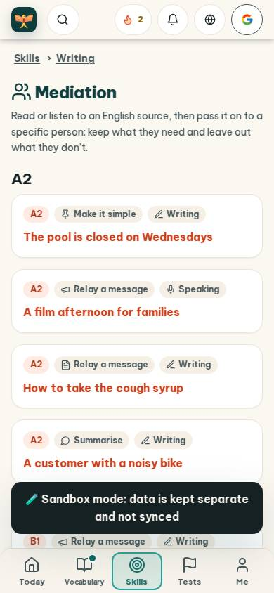
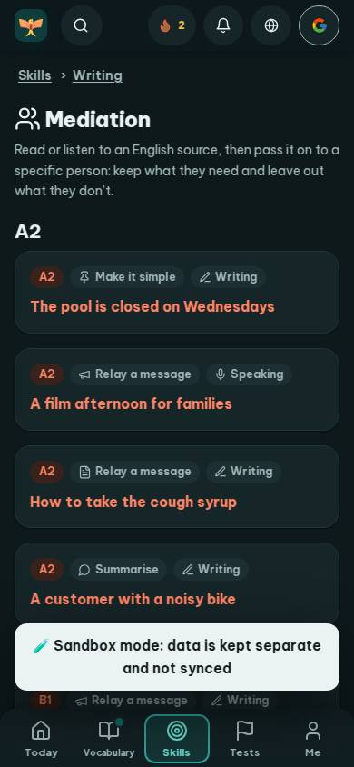
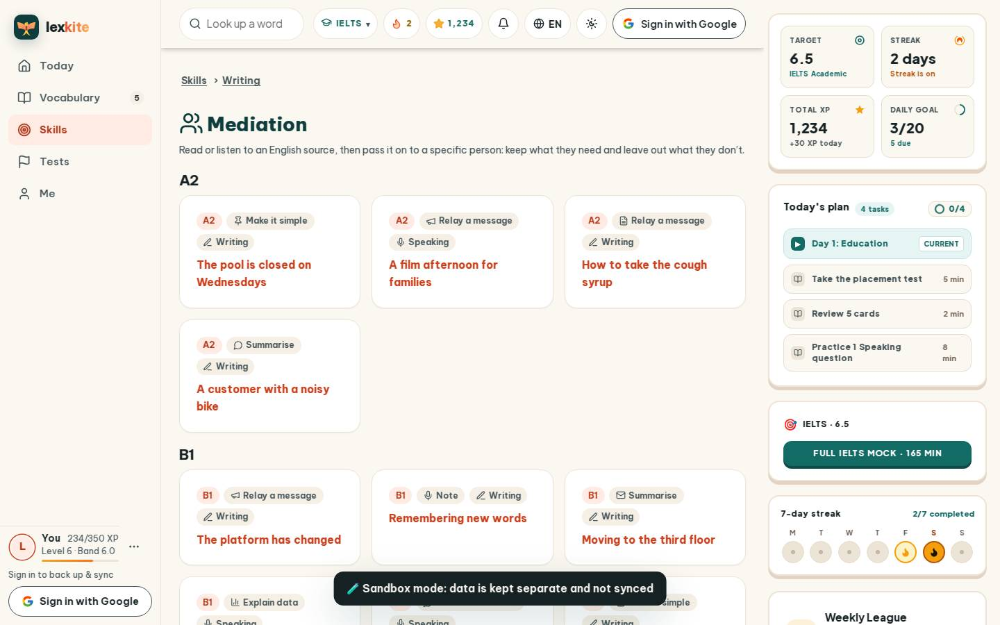
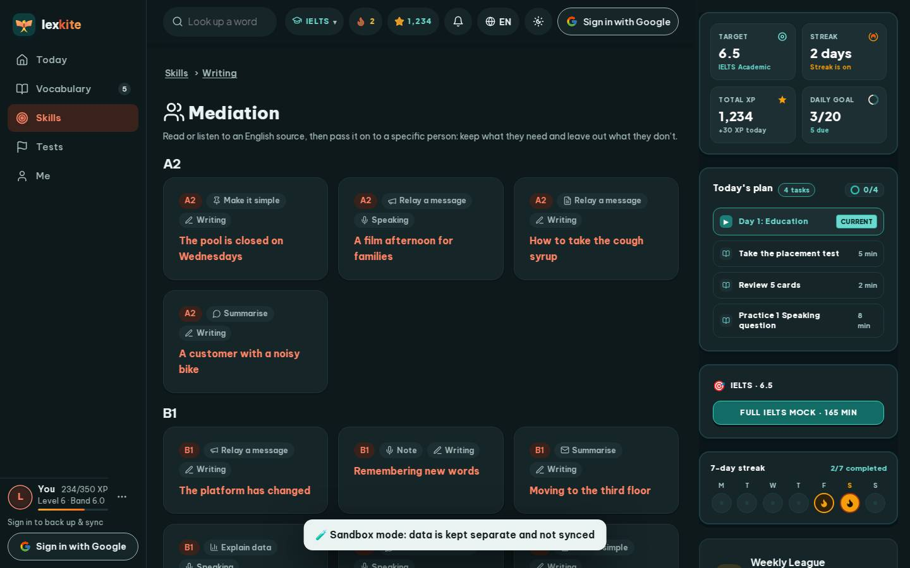

# #/mediate

Điểm: **92** · độ phủ 100 % · /mediate

- Chức năng: 100
- Lỗi JS: 100
- Rỗng/lỗi/tải: 100
- Back/Thoát: –
- Tương phản: 90
- Chạm ≥44: 100
- Bố cục: 100
- i18n 15: 100
- Hiệu năng: 50
- Độ đẹp: 81

## Lỗi
- [contrast] a[data-ext-cta="rail"]
- [perf] LCP 6280 ms · CLS 0.0031 · TBT 77 ms
- [beauty] Dark toast banner obscures content and breaks visual flow
- [beauty] No character or illustration integration, feels generic
- [beauty] Top nav icons feel crowded and inconsistent in style

## Ảnh
390l 
390d 
1440l 
1440d 
