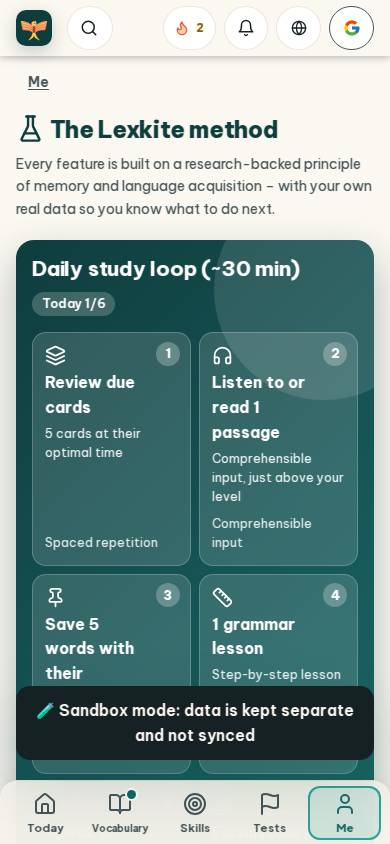
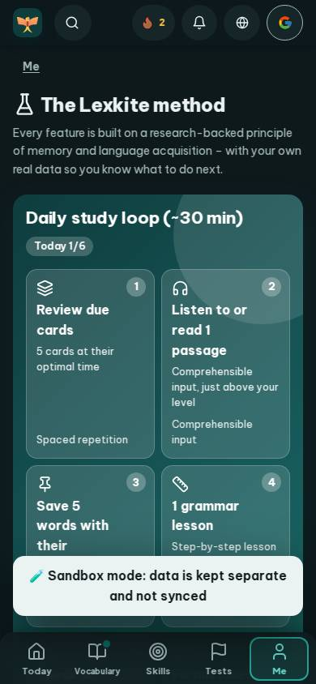
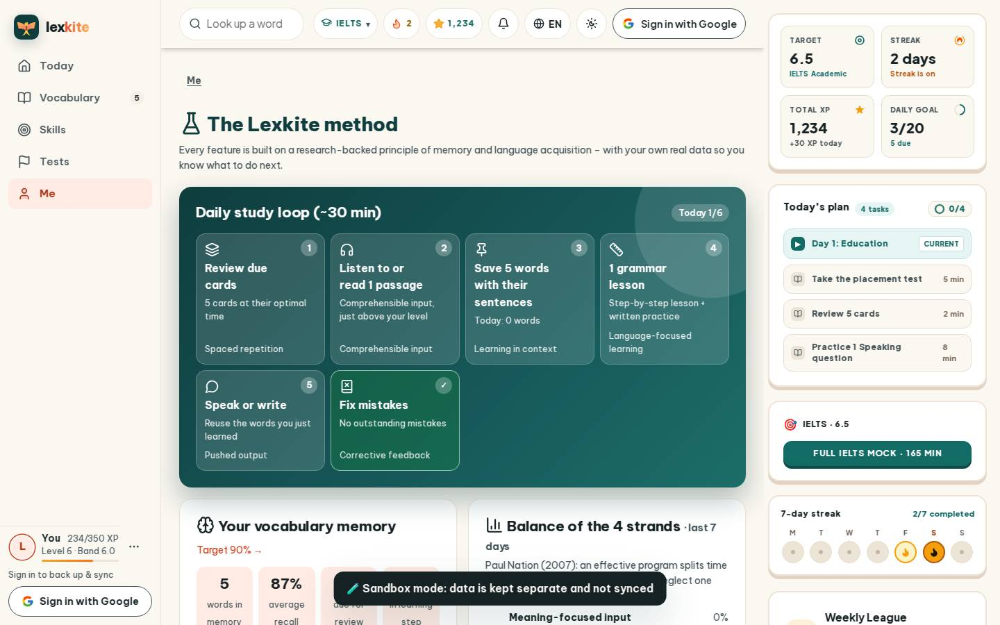

# #/method

Điểm: **84** · độ phủ 100 % · /method

- Chức năng: 100
- Lỗi JS: 100
- Rỗng/lỗi/tải: 100
- Back/Thoát: –
- Tương phản: 90
- Chạm ≥44: 76
- Bố cục: 85
- i18n 15: 47
- Hiệu năng: 50
- Độ đẹp: 81

## Lỗi
- [contrast] a[data-ext-cta="rail"]
- [tap] div.card>div.row.between>a.small – "Target 90% →" vùng chạm 96×22 < 44px
- [tap] div.card>div.tiny.muted>a – "See the full path →" vùng chạm 125×18 < 44px
- [tap] div.card>details>summary – "How many new words should I learn each d" vùng chạm 767×25 < 44px
- [layout] main#view>div.card.hero-main – nội dung tràn ngang 60px bị cắt
- [i18n] de: thiếu dịch «Fading»
- [i18n] es: thiếu dịch «Speaking room»
- [i18n] fr: thiếu dịch «Fading» · thiếu dịch «Phrasebook»
- [i18n] id: thiếu dịch «Fading»
- [perf] LCP 5980 ms · CLS 0.0031 · TBT 76 ms
- [beauty] Redundant 'Comprehensible input' text in card 2
- [beauty] Toast notification obscures bottom card content
- [beauty] Generic icons lack Duolingo's character polish

## Ảnh
390l 
390d 
1440l 
1440d 
