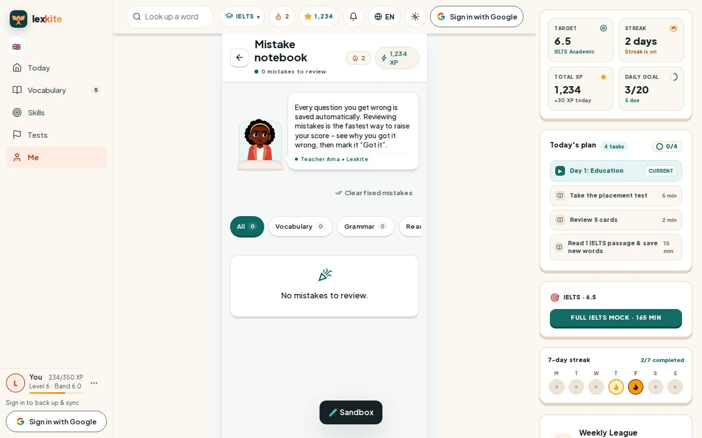

# #/mistakes

Điểm: **93** · độ phủ 100 % · /mistakes

- Chức năng: 100
- Lỗi JS: 100
- Rỗng/lỗi/tải: 100
- Back/Thoát: –
- Tương phản: 100
- Chạm ≥44: 92
- Bố cục: 100
- i18n 15: 100
- Hiệu năng: 63
- Độ đẹp: 77

## Lỗi
- [tap] button#clearFixed – "Clear fixed mistakes" vùng chạm 175×36 < 44px
- [perf] LCP 5112 ms · CLS 0.0039 · TBT 0 ms
- [beauty] Tab labels are truncated (e.g., 'Gram')
- [beauty] Empty-state icon looks like a raw placeholder
- [beauty] Generic, flat styling lacks Duolingo's playful polish

## Ảnh
390l 
390d 
1440l 
1440d 
