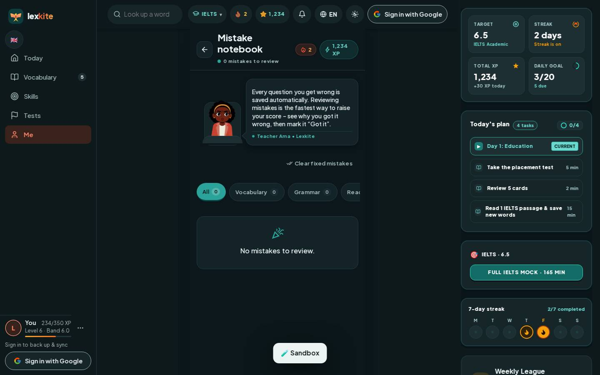

# #/mistakes

Điểm: **92** · độ phủ 86 % · /mistakes

- Chức năng: 100
- Lỗi JS: 100
- Rỗng/lỗi/tải: 100
- Back/Thoát: –
- Tương phản: 100
- Chạm ≥44: 100
- Bố cục: 70
- i18n 15: 100
- Hiệu năng: 58
- Độ đẹp: ∅

## Lỗi
- [layout] nav#mTabs>button.shrink-0.px-3.5 – "Reading 0" lòi ra ngoài nav#mTabs 97px
- [layout] header.sticky.top-0>div.flex.items-center>button.w-10.h-10 – "arrow_back" bị div.h-14.px-[1rem]>div.flex.items-center>a.flex.items-center đè
- [perf] LCP 5472 ms · CLS 0.0001 · TBT 39 ms

## Ảnh
390l 
390d 
1440l 
1440d 
