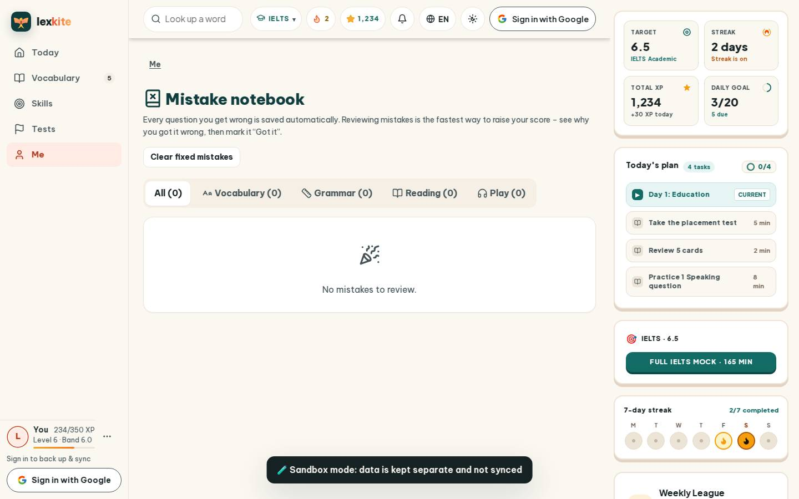
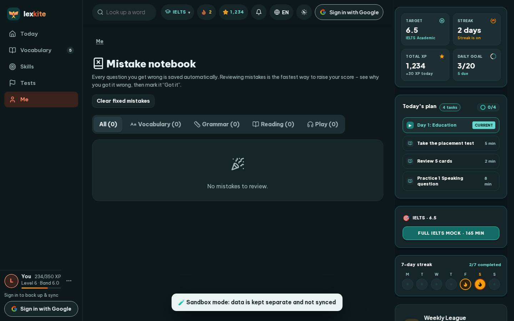

# #/mistakes

Điểm: **93** · độ phủ 100 % · /mistakes

- Chức năng: 100
- Lỗi JS: 100
- Rỗng/lỗi/tải: 100
- Back/Thoát: –
- Tương phản: 100
- Chạm ≥44: 92
- Bố cục: 100
- i18n 15: 100
- Hiệu năng: 63
- Độ đẹp: 78

## Lỗi
- [tap] button#clearFixed – "Clear fixed mistakes" vùng chạm 175×36 < 44px
- [perf] LCP 5064 ms · CLS 0.0031 · TBT 19 ms
- [beauty] Generic, flat UI lacks Duolingo's playful character integration
- [beauty] Top nav icons feel cluttered and inconsistent in style
- [beauty] Empty-state card is plain and visually weak

## Ảnh
390l 
390d 
1440l 
1440d 
