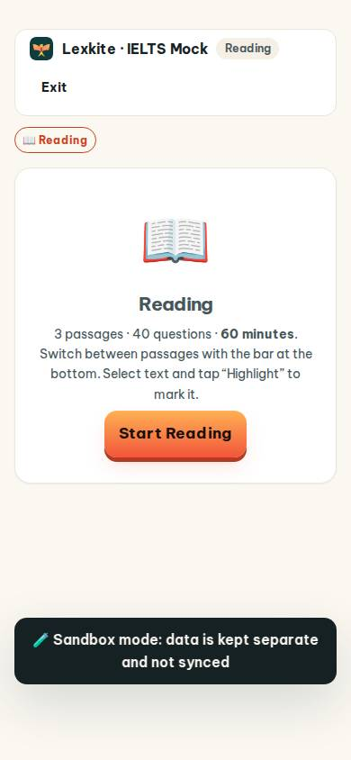
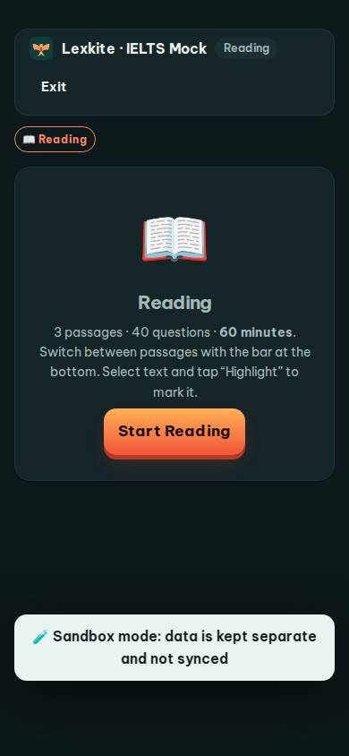
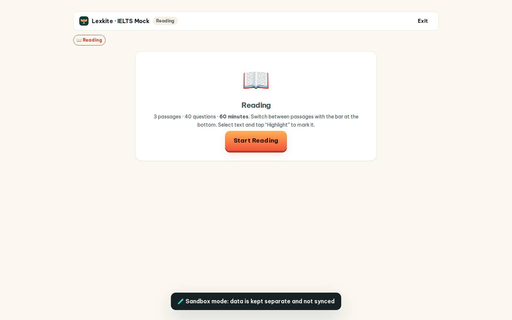
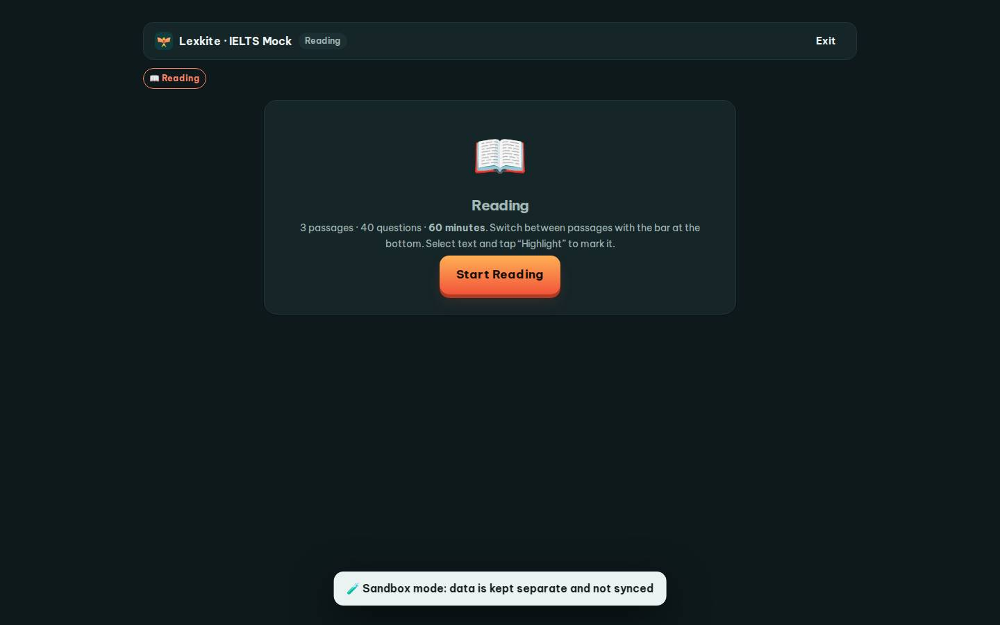

# #/mock

Điểm: **86** · độ phủ 100 % · /mock/run?s=reading&r=1&l=1

- Chức năng: 100
- Lỗi JS: 100
- Rỗng/lỗi/tải: 100
- Back/Thoát: 100
- Tương phản: 100
- Chạm ≥44: 100
- Bố cục: 100
- i18n 15: 13
- Hiệu năng: 78
- Độ đẹp: 72

## Lỗi
- [i18n] ar: thiếu dịch «Reading»
- [i18n] de: thiếu dịch «Reading»
- [i18n] es: thiếu dịch «Reading»
- [i18n] fr: thiếu dịch «Reading»
- [perf] LCP 4008 ms · CLS 0 · TBT 92 ms
- [beauty] Sandbox mode banner looks like a raw debug toast
- [beauty] Generic emoji icon feels pasted, not integrated
- [beauty] Uneven vertical spacing creates a cluttered rhythm

## Ảnh
390l 
390d 
1440l 
1440d 
