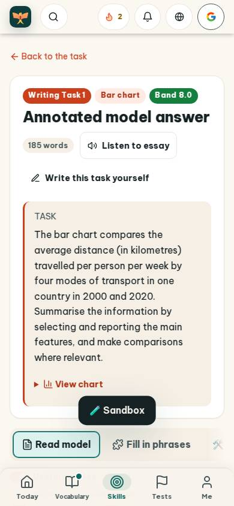
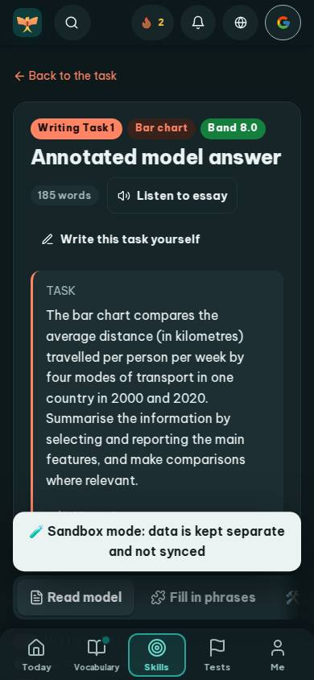
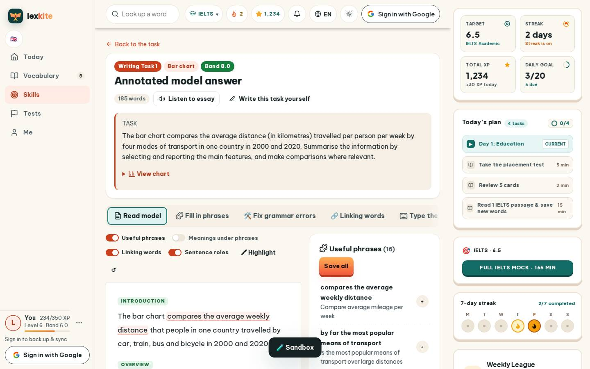
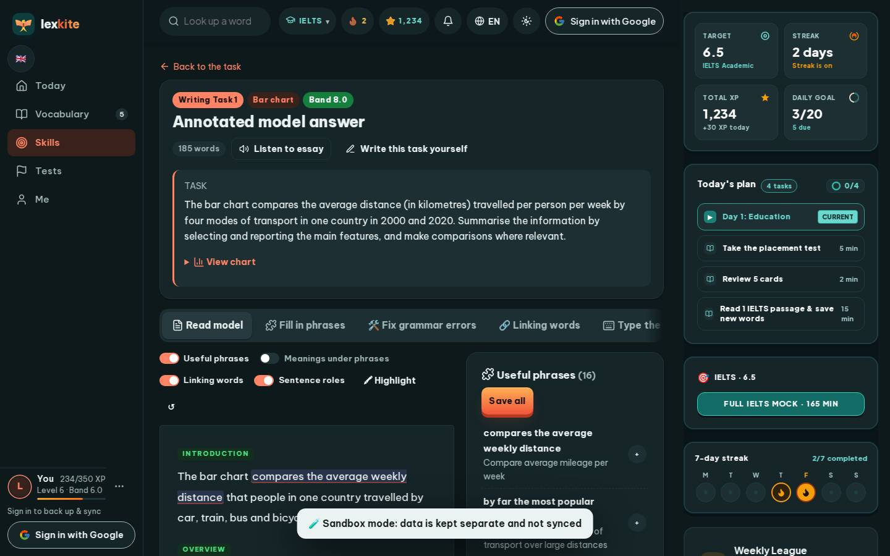

# #/model/t1-travel

Điểm: **91** · độ phủ 86 % · /model/t1-travel

- Chức năng: 100
- Lỗi JS: 100
- Rỗng/lỗi/tải: 100
- Back/Thoát: –
- Tương phản: 100
- Chạm ≥44: 60
- Bố cục: 85
- i18n 15: 100
- Hiệu năng: 50
- Độ đẹp: ∅

## Lỗi
- [tap] article#annot>p>span.an-ch – "gained in popularity" vùng chạm 157×20 < 44px
- [tap] button#readM – "Listen to essay" vùng chạm 162×36 < 44px
- [tap] div.row.between>div.row>a.btn.sm – "Write this task yourself" vùng chạm 224×36 < 44px
- [tap] button#hlMode – "🖍 Highlight" vùng chạm 111×36 < 44px
- [tap] button#hlClear – "↺" vùng chạm 38×36 < 44px
- [layout] button#hlClear – "↺" rớt xuống đứng một mình ở dòng cuối của div#anBar
- [perf] LCP 7540 ms · CLS 0.0033 · TBT 20 ms

## Ảnh
390l 
390d 
1440l 
1440d 
