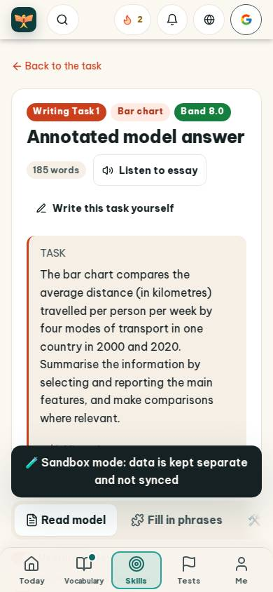
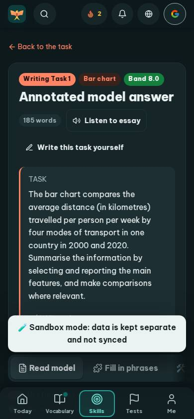
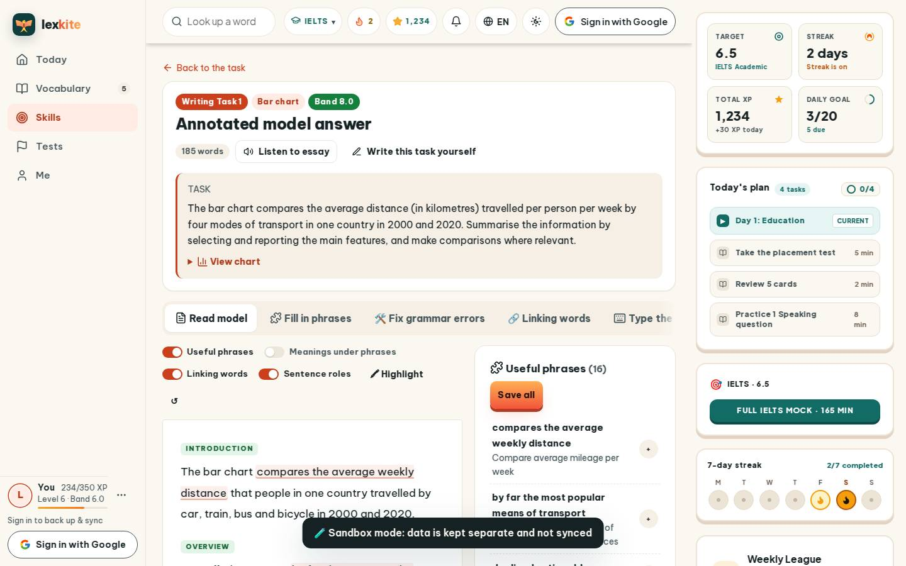
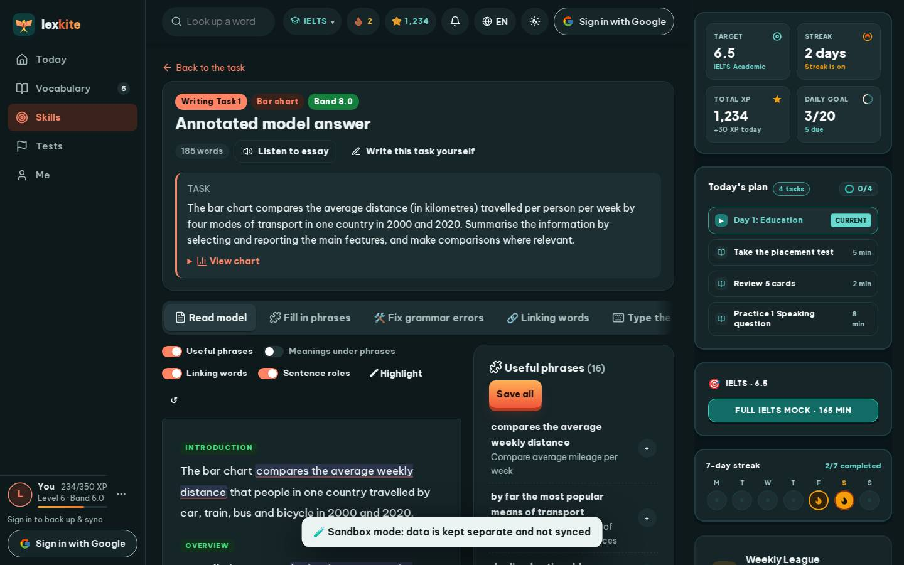

# #/model/t1-travel

Điểm: **79** · độ phủ 100 % · /model/t1-travel

- Chức năng: 100
- Lỗi JS: 100
- Rỗng/lỗi/tải: 100
- Back/Thoát: –
- Tương phản: 100
- Chạm ≥44: 36
- Bố cục: 85
- i18n 15: 13
- Hiệu năng: 50
- Độ đẹp: 77

## Lỗi
- [tap] article#annot>p>span.an-ch – "gained in popularity" vùng chạm 157×20 < 44px
- [tap] main#view>a.small – "Back to the task" vùng chạm 132×18 < 44px
- [tap] button#readM – "Listen to essay" vùng chạm 162×36 < 44px
- [tap] div.row.between>div.row>a.btn.sm – "Write this task yourself" vùng chạm 224×36 < 44px
- [tap] div.md-prompt>details.md-chart>summary.small – "View chart" vùng chạm 738×23 < 44px
- [layout] button#hlClear – "↺" rớt xuống đứng một mình ở dòng cuối của div#anBar
- [i18n] ar: thiếu dịch «Writing Task 1»
- [i18n] de: thiếu dịch «Writing Task 1»
- [i18n] es: thiếu dịch «Writing Task 1»
- [i18n] fr: thiếu dịch «Writing Task 1»
- [perf] LCP 6848 ms · CLS 0.0031 · TBT 67 ms
- [beauty] Dark toast banner overlaps primary action buttons, blocking interaction
- [beauty] Top nav icons (streak, bell, globe, Google) feel cluttered and inconsistent
- [beauty] Mixed red/green pill badges lack clear visual hierarchy

## Ảnh
390l 
390d 
1440l 
1440d 
