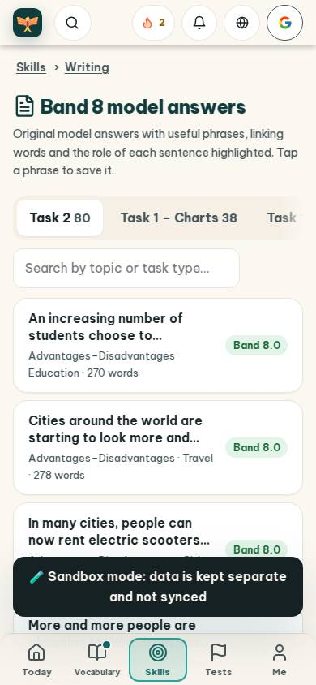
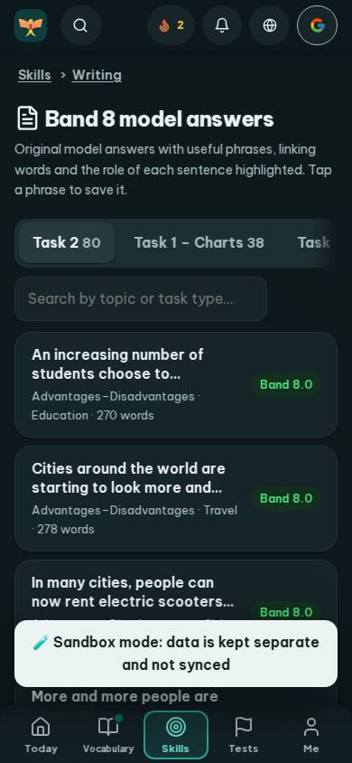
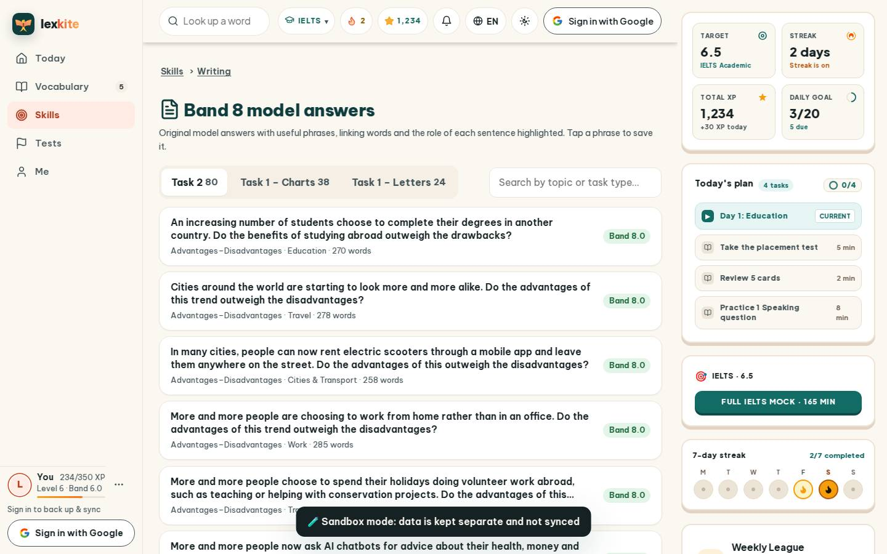
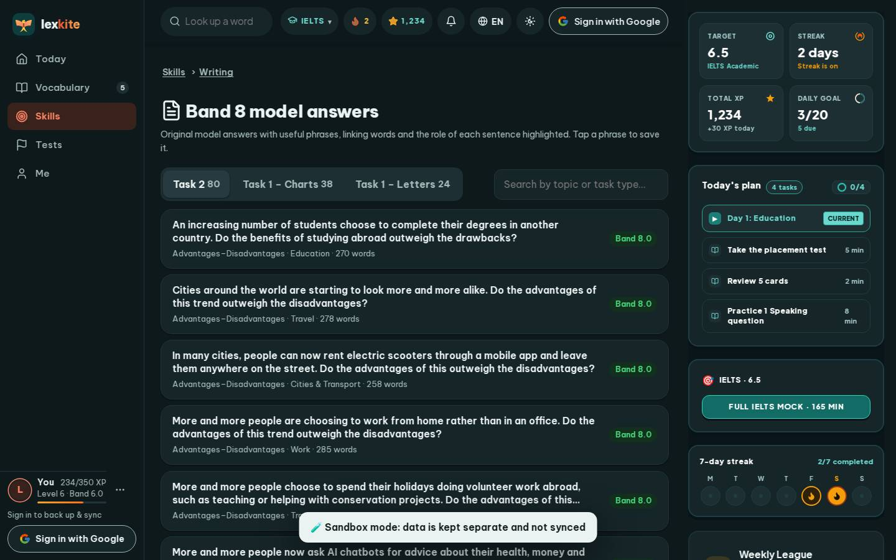

# #/models

Điểm: **91** · độ phủ 100 % · /models

- Chức năng: 100
- Lỗi JS: 100
- Rỗng/lỗi/tải: 100
- Back/Thoát: –
- Tương phản: 90
- Chạm ≥44: 100
- Bố cục: 100
- i18n 15: 100
- Hiệu năng: 50
- Độ đẹp: 79

## Lỗi
- [contrast] a[data-ext-cta="rail"]
- [perf] LCP 7036 ms · CLS 0.0031 · TBT 107 ms
- [beauty] Dark toast notification obscures content and bottom nav
- [beauty] Tab bar text is cut off on the right edge
- [beauty] Generic card list lacks Duolingo's playful character integration

## Ảnh
390l 
390d 
1440l 
1440d 
