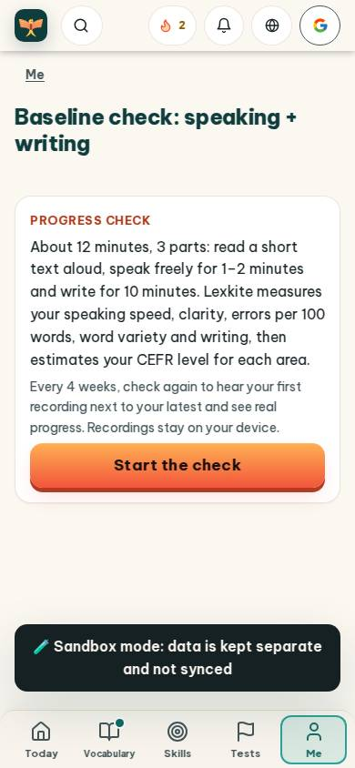
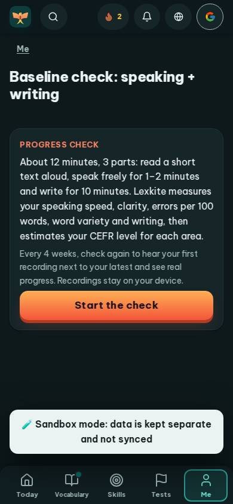
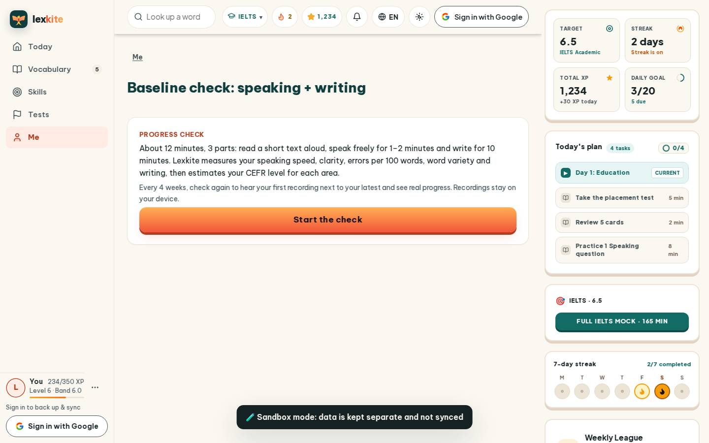
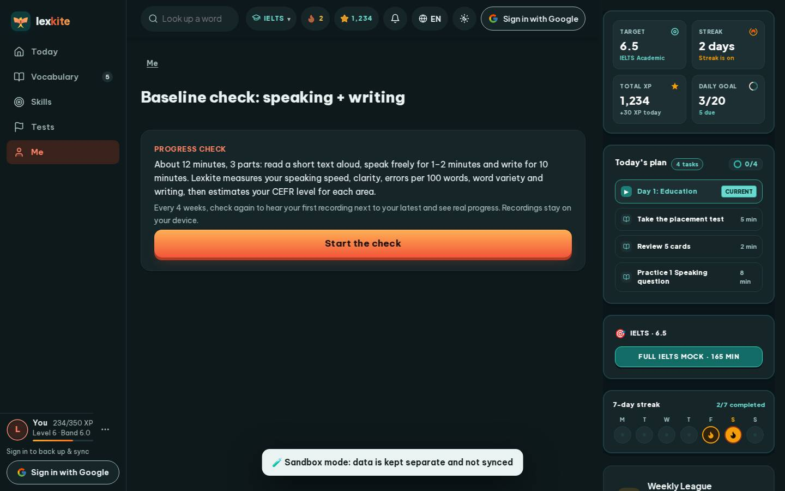

# #/outcome

Điểm: **93** · độ phủ 100 % · /outcome

- Chức năng: 100
- Lỗi JS: 100
- Rỗng/lỗi/tải: 100
- Back/Thoát: –
- Tương phản: 100
- Chạm ≥44: 100
- Bố cục: 100
- i18n 15: 100
- Hiệu năng: 62
- Độ đẹp: 77

## Lỗi
- [perf] LCP 5152 ms · CLS 0.0031 · TBT 24 ms
- [beauty] Generic sans-serif typography lacks Duolingo's distinctive playful character
- [beauty] Flat, unbranded icons in top bar and bottom nav feel utilitarian
- [beauty] Large empty whitespace between main card and sandbox banner disrupts rhythm

## Ảnh
390l 
390d 
1440l 
1440d 
