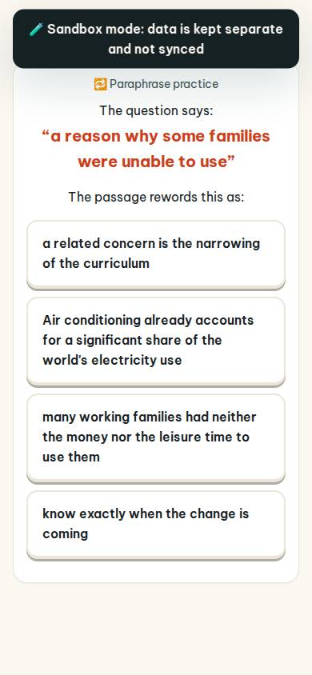
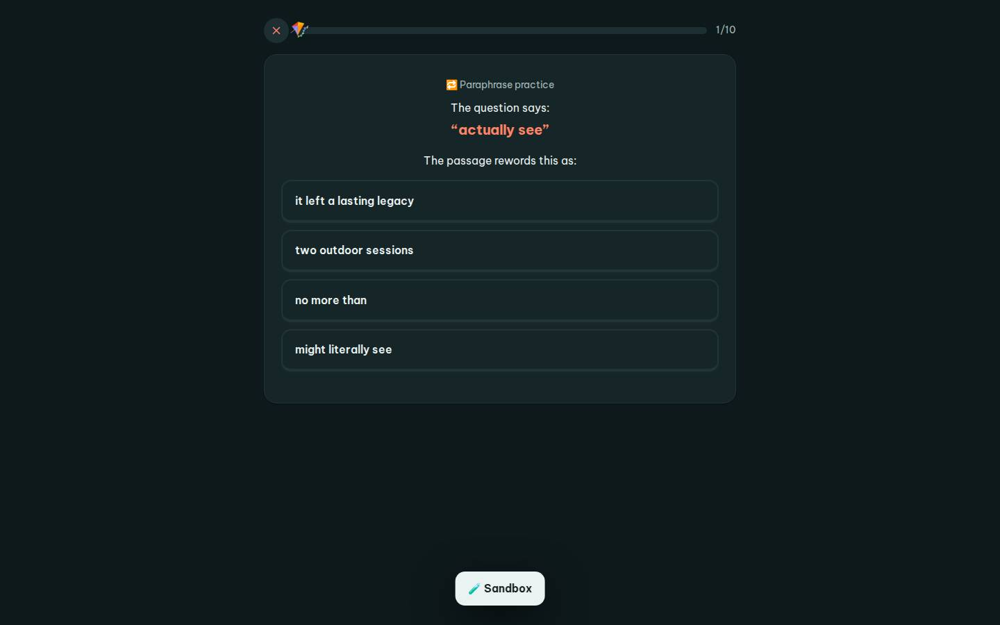

# #/paraphrase

Điểm: **94** · độ phủ 100 % · /paraphrase

- Chức năng: 100
- Lỗi JS: 100
- Rỗng/lỗi/tải: 100
- Back/Thoát: 100
- Tương phản: 100
- Chạm ≥44: 100
- Bố cục: 100
- i18n 15: 100
- Hiệu năng: 76
- Độ đẹp: 71

## Lỗi
- [perf] LCP 4148 ms · CLS 0 · TBT 47 ms
- [beauty] Sandbox mode banner looks like a raw debug overlay, not integrated UI
- [beauty] Generic white cards with hard drop shadows feel flat and unpolished
- [beauty] No character or brand illustration; layout is plain and text-heavy

## Ảnh
390l 
390d 
1440l 
1440d 
