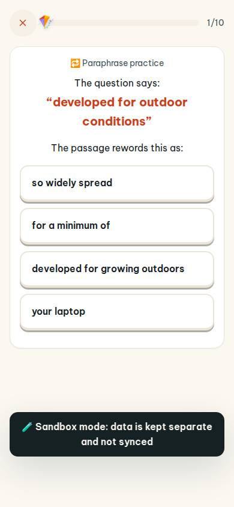
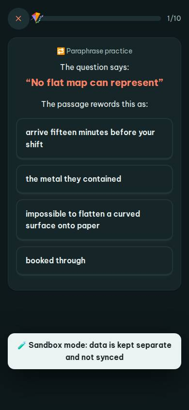
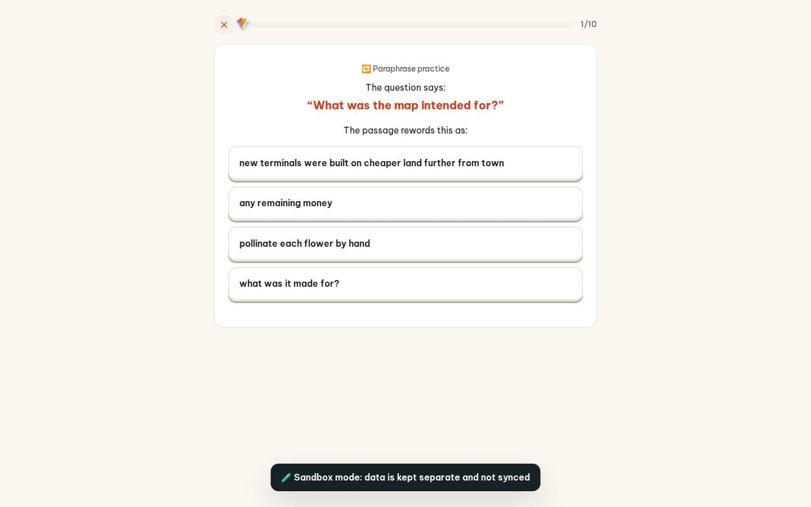
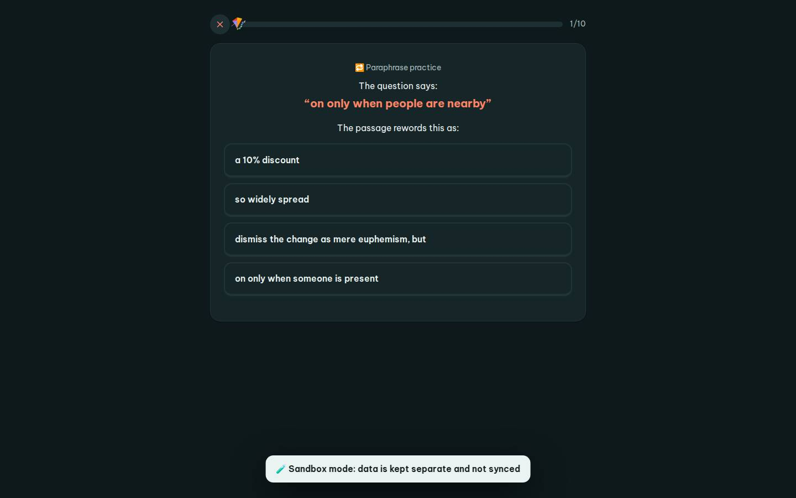

# #/paraphrase

Điểm: **94** · độ phủ 100 % · /paraphrase

- Chức năng: 100
- Lỗi JS: 100
- Rỗng/lỗi/tải: 100
- Back/Thoát: 100
- Tương phản: 100
- Chạm ≥44: 100
- Bố cục: 100
- i18n 15: 100
- Hiệu năng: 75
- Độ đẹp: 72

## Lỗi
- [perf] LCP 4280 ms · CLS 0 · TBT 198 ms
- [beauty] Generic flat buttons lack Duolingo's playful 3D depth and character integration.
- [beauty] Dark toast notification at the bottom feels utilitarian and clashes with the light theme.
- [beauty] Layout is clean but visually generic, lacking distinct brand personality or illustration.

## Ảnh
390l 
390d 
1440l 
1440d 
