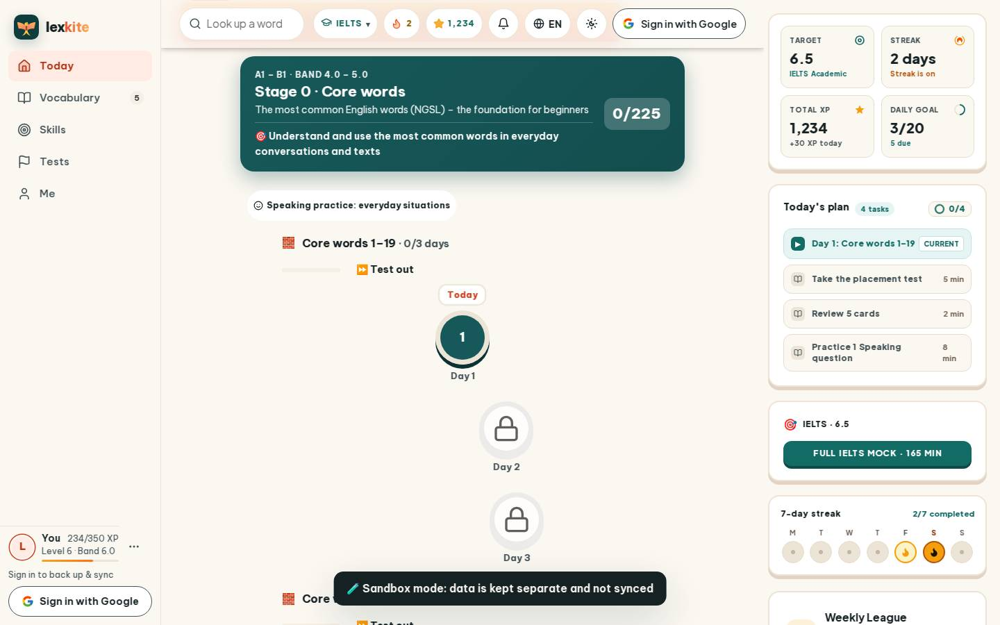
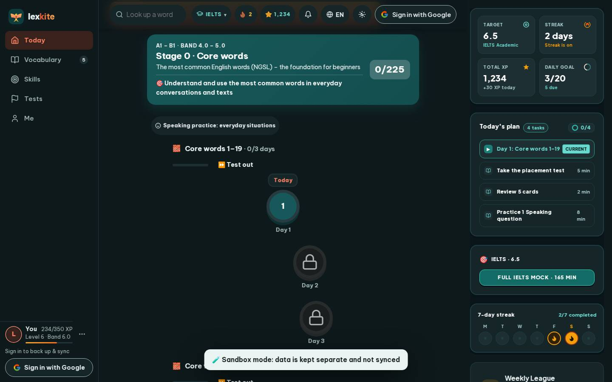

# #/path

Điểm: **93** · độ phủ 100 % · /path

- Chức năng: 100
- Lỗi JS: 100
- Rỗng/lỗi/tải: 100
- Back/Thoát: –
- Tương phản: 90
- Chạm ≥44: 92
- Bố cục: 100
- i18n 15: 100
- Hiệu năng: 75
- Độ đẹp: 76

## Lỗi
- [contrast] a[data-ext-cta="rail"]
- [tap] div.dp-body>div.dp-unit>a.btn.sm – "⏩ Test out" vùng chạm 109×40 < 44px
- [perf] LCP 4264 ms · CLS 0.0031 · TBT 161 ms
- [beauty] Dark toast banner obscures primary 'Day 1' action node.
- [beauty] Top nav bar is crowded with 6 disparate icons.
- [beauty] No character or illustration integration, feels generic.

## Ảnh
390l 
390d 
1440l 
1440d 
