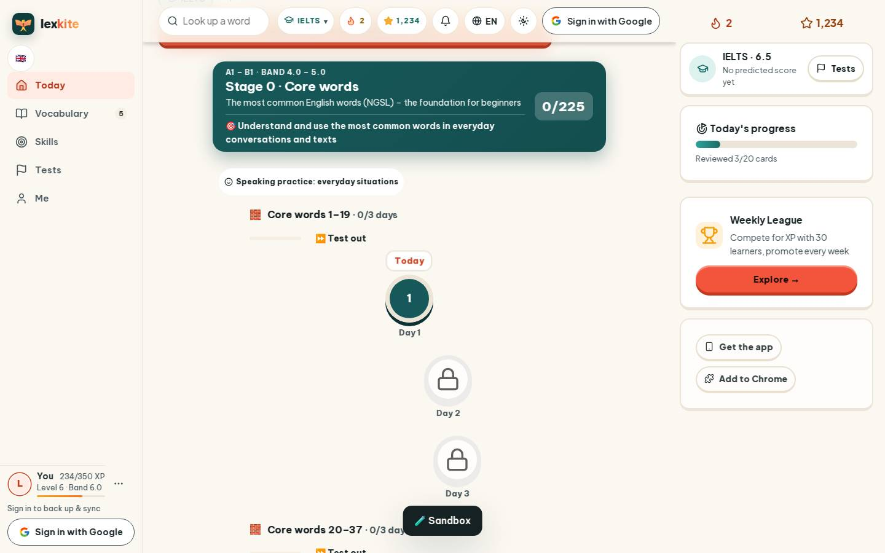
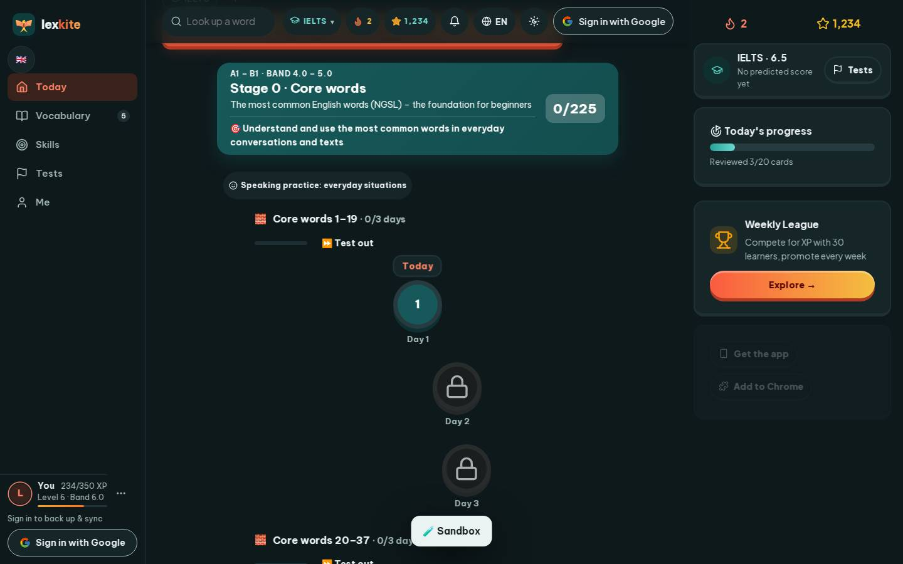

# #/path

Điểm: **95** · độ phủ 100 % · /path

- Chức năng: 100
- Lỗi JS: 100
- Rỗng/lỗi/tải: 100
- Back/Thoát: –
- Tương phản: 100
- Chạm ≥44: 92
- Bố cục: 100
- i18n 15: 100
- Hiệu năng: 85
- Độ đẹp: 77

## Lỗi
- [tap] div.dp-body>div.dp-unit>a.btn.sm – "⏩ Test out" vùng chạm 109×40 < 44px
- [perf] LCP 3556 ms · CLS 0.0039 · TBT 106 ms
- [beauty] Dark 'Sandbox mode' toast obscures primary path node
- [beauty] Top icon row feels crowded and unaligned
- [beauty] No character/illustration integration; layout feels generic

## Ảnh
390l 
390d 
1440l 
1440d 
