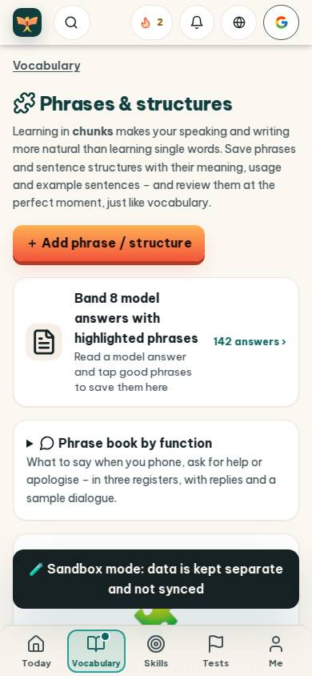
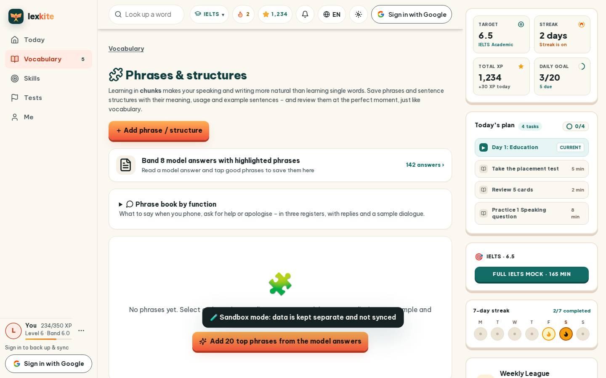
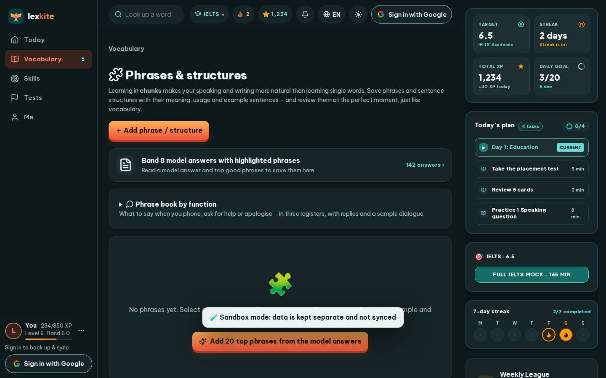

# #/phrases

Điểm: **92** · độ phủ 100 % · /phrases

- Chức năng: 100
- Lỗi JS: 100
- Rỗng/lỗi/tải: 100
- Back/Thoát: –
- Tương phản: 100
- Chạm ≥44: 100
- Bố cục: 100
- i18n 15: 100
- Hiệu năng: 50
- Độ đẹp: 79

## Lỗi
- [perf] LCP 6800 ms · CLS 0.0031 · TBT 21 ms
- [beauty] Generic sans-serif typography lacks Duolingo's distinctive playful font.
- [beauty] Flat, generic icons and lack of character integration feel utilitarian.
- [beauty] Orange button has a heavy, dated drop shadow.

## Ảnh
390l 
390d 
1440l 
1440d 
