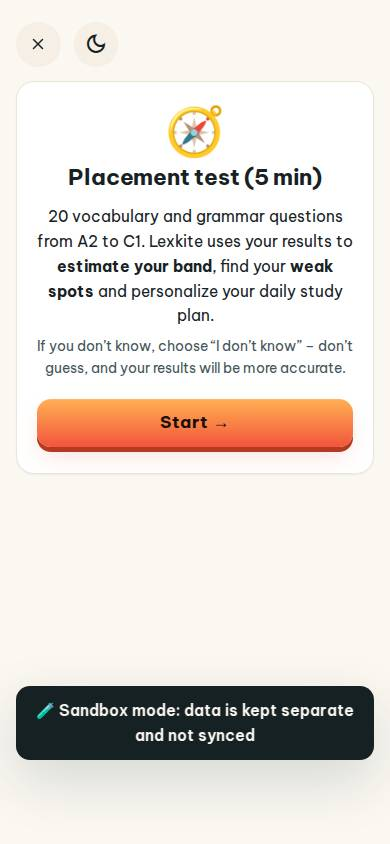
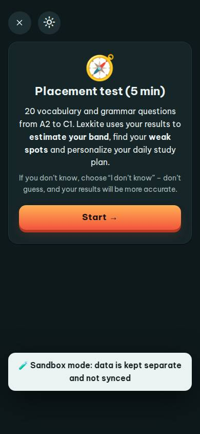
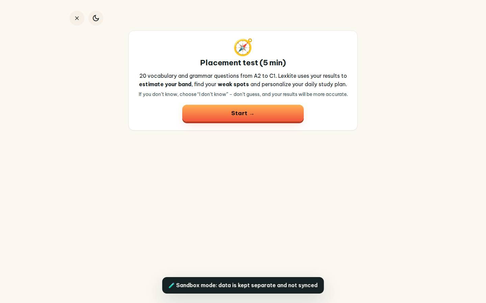
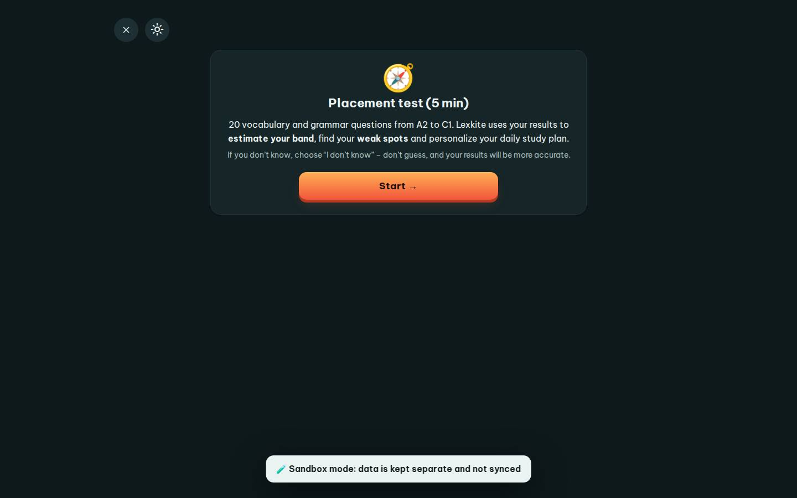

# #/placement

Điểm: **93** · độ phủ 100 % · /placement

- Chức năng: 100
- Lỗi JS: 100
- Rỗng/lỗi/tải: 100
- Back/Thoát: 100
- Tương phản: 100
- Chạm ≥44: 100
- Bố cục: 100
- i18n 15: 100
- Hiệu năng: 50
- Độ đẹp: 82

## Lỗi
- [perf] LCP 9708 ms · CLS 0 · TBT 10 ms
- [beauty] Sandbox mode toast feels like a raw dev overlay, not a polished UI element.
- [beauty] Large empty vertical space below the card creates awkward, unbalanced rhythm.
- [beauty] Top-left close and theme buttons feel visually disconnected from the main card.

## Ảnh
390l 
390d 
1440l 
1440d 
