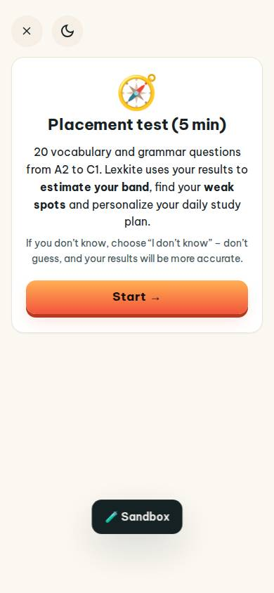
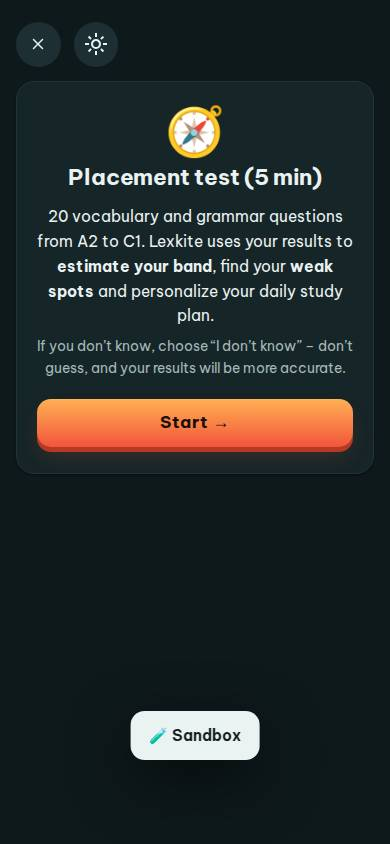
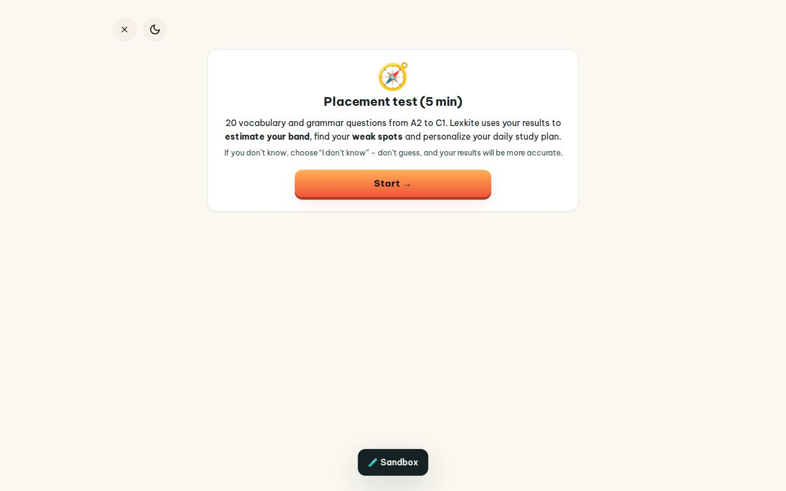
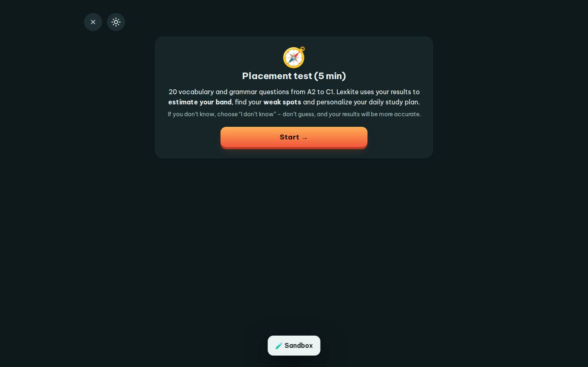

# #/placement

Điểm: **96** · độ phủ 100 % · /placement

- Chức năng: 100
- Lỗi JS: 100
- Rỗng/lỗi/tải: 100
- Back/Thoát: 100
- Tương phản: 100
- Chạm ≥44: 100
- Bố cục: 100
- i18n 15: 100
- Hiệu năng: 79
- Độ đẹp: 84

## Lỗi
- [perf] LCP 3940 ms · CLS 0.0007 · TBT 123 ms
- [beauty] Sandbox mode toast looks like a raw debug flag, not a polished UI element
- [beauty] Large empty vertical space between card and toast breaks visual rhythm
- [beauty] Top and bottom screenshots overlap, creating a cluttered, unfinished feel

## Ảnh
390l 
390d 
1440l 
1440d 
