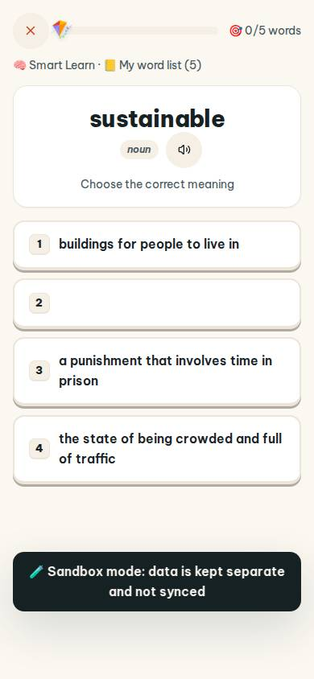
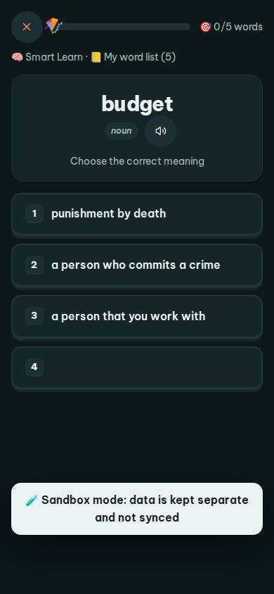
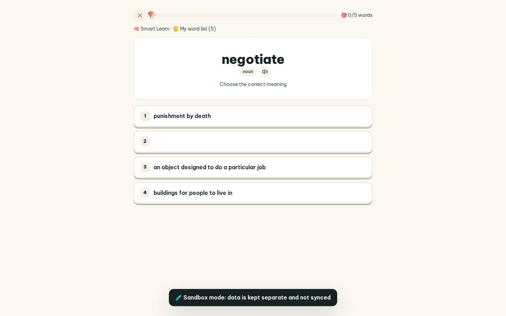
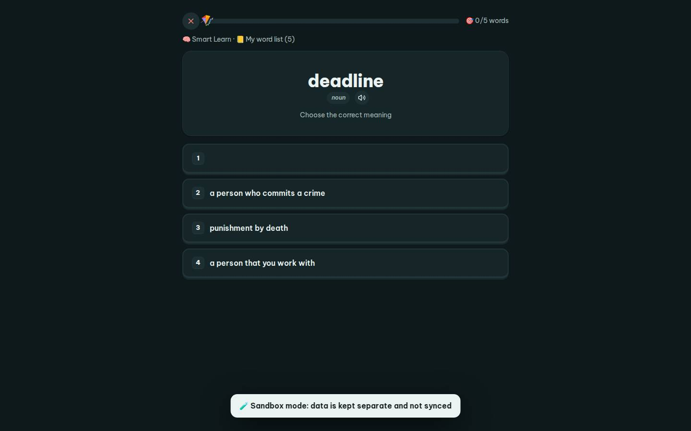

# #/practice/learn

Điểm: **86** · độ phủ 100 % · /practice/learn

- Chức năng: 100
- Lỗi JS: 100
- Rỗng/lỗi/tải: 100
- Back/Thoát: 100
- Tương phản: 100
- Chạm ≥44: 100
- Bố cục: 100
- i18n 15: 13
- Hiệu năng: 79
- Độ đẹp: 72

## Lỗi
- [i18n] ar: thiếu dịch «noun»
- [i18n] de: thiếu dịch «noun»
- [i18n] es: thiếu dịch «noun»
- [i18n] fr: thiếu dịch «noun»
- [perf] LCP 3960 ms · CLS 0 · TBT 43 ms
- [beauty] Option 2 is empty, looking broken/unfinished
- [beauty] Dark 'Sandbox mode' banner is intrusive and clutters the flow
- [beauty] Generic flat cards lack Duolingo's playful character integration

## Ảnh
390l 
390d 
1440l 
1440d 
