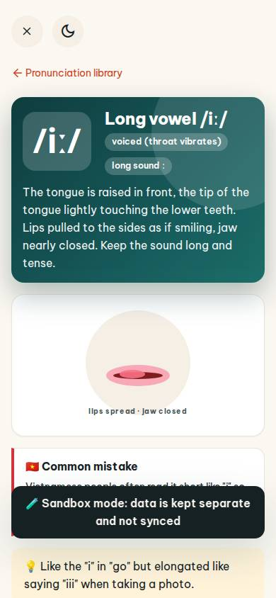
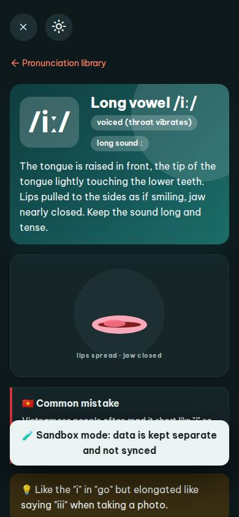
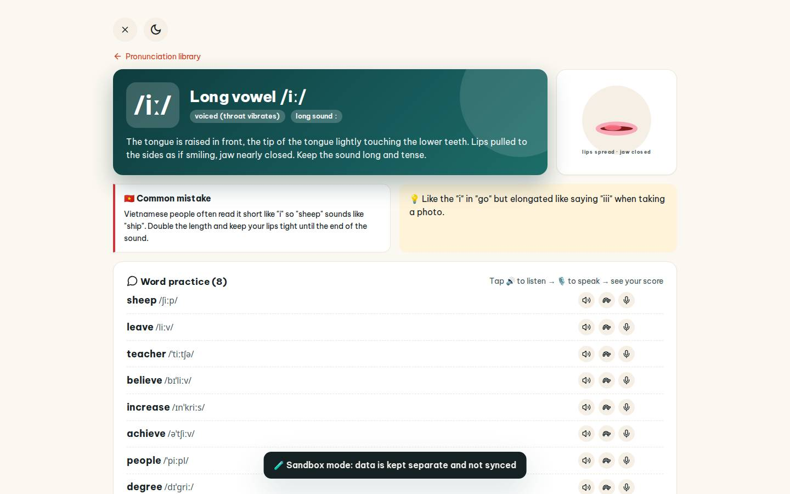
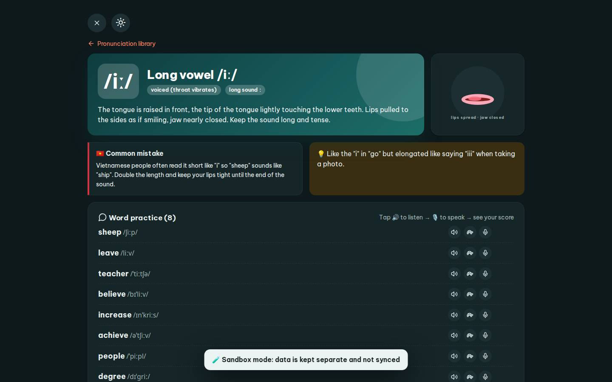

# #/pron

Điểm: **91** · độ phủ 100 % · /pron

- Chức năng: 100
- Lỗi JS: 100
- Rỗng/lỗi/tải: 100
- Back/Thoát: 100
- Tương phản: 100
- Chạm ≥44: 92
- Bố cục: 85
- i18n 15: 100
- Hiệu năng: 57
- Độ đẹp: 77

## Lỗi
- [tap] main#view>a.small – "Pronunciation library" vùng chạm 160×18 < 44px
- [layout] div#pHead>div.card.hero-main – nội dung tràn ngang 60px bị cắt
- [perf] LCP 5504 ms · CLS 0 · TBT 101 ms
- [beauty] A dark 'Sandbox mode' toast obscures the 'Common mistake' card content.
- [beauty] The mouth illustration is a simple, flat graphic that lacks Duolingo's character polish.
- [beauty] The top header bar appears duplicated or misaligned in the upper section.

## Ảnh
390l 
390d 
1440l 
1440d 
