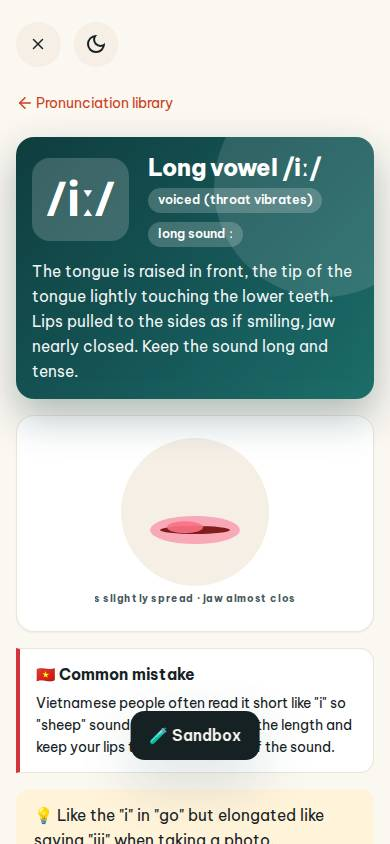
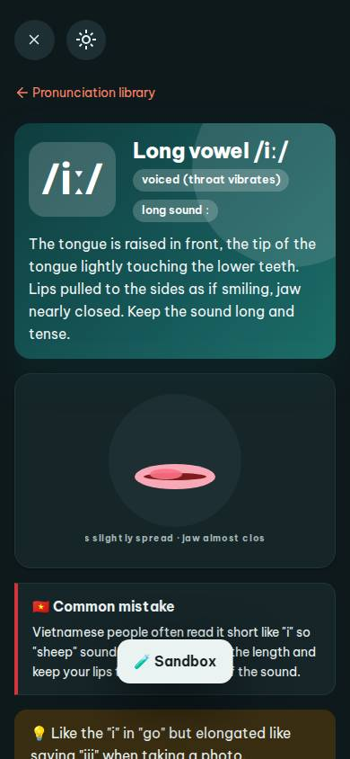
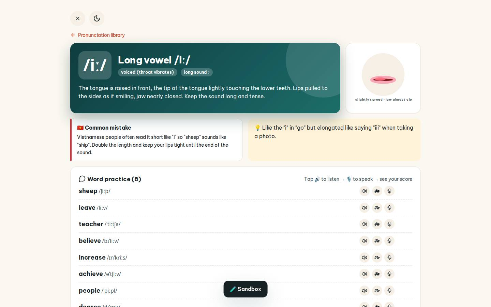
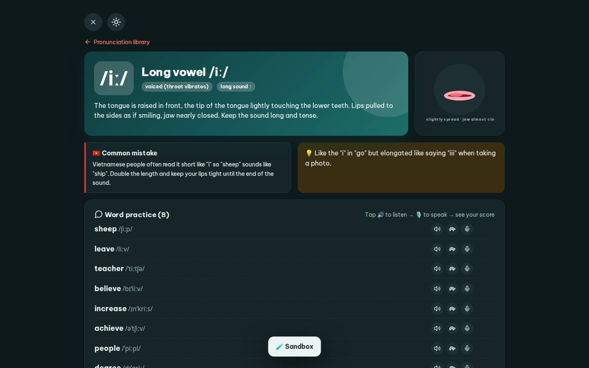

# #/pron

Điểm: **92** · độ phủ 100 % · /pron

- Chức năng: 100
- Lỗi JS: 100
- Rỗng/lỗi/tải: 100
- Back/Thoát: 100
- Tương phản: 100
- Chạm ≥44: 100
- Bố cục: 85
- i18n 15: 100
- Hiệu năng: 50
- Độ đẹp: 81

## Lỗi
- [layout] div#pHead>div.card.hero-main – nội dung tràn ngang 60px bị cắt
- [perf] LCP 6424 ms · CLS 0.0007 · TBT 189 ms
- [beauty] Dark toast notification obscures content
- [beauty] Inconsistent icon styles (emoji vs vector)
- [beauty] No clear primary action button

## Ảnh
390l 
390d 
1440l 
1440d 
