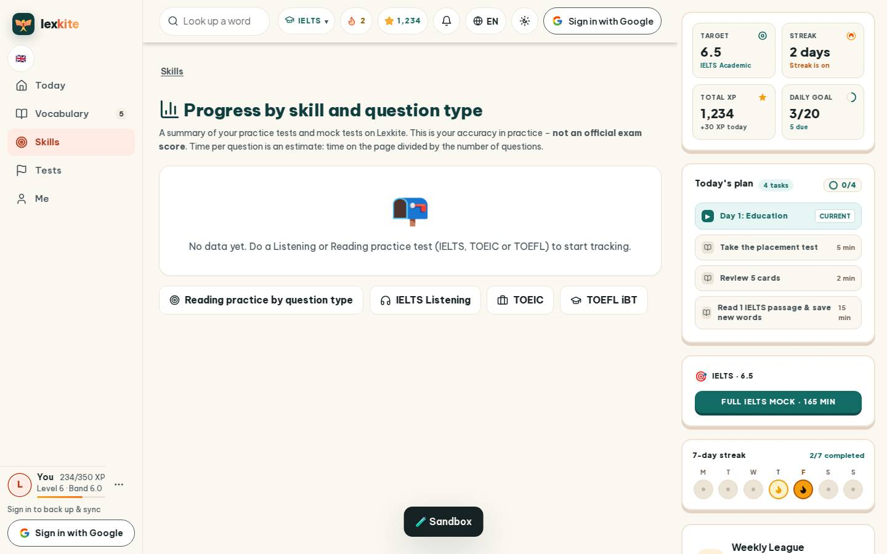
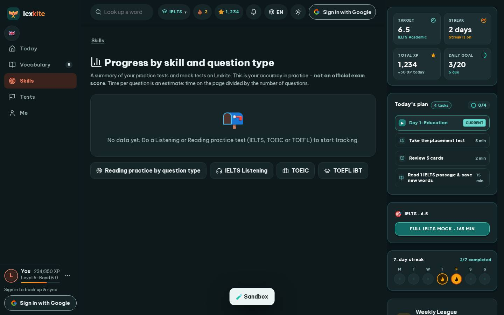

# #/qstats

Điểm: **93** · độ phủ 100 % · /qstats

- Chức năng: 100
- Lỗi JS: 100
- Rỗng/lỗi/tải: 100
- Back/Thoát: –
- Tương phản: 100
- Chạm ≥44: 100
- Bố cục: 100
- i18n 15: 100
- Hiệu năng: 59
- Độ đẹp: 75

## Lỗi
- [perf] LCP 5352 ms · CLS 0.0039 · TBT 45 ms
- [beauty] Dark toast overlay obscures primary content and actions
- [beauty] Generic mailbox icon feels pasted, not integrated
- [beauty] Uneven button grid alignment (2+1 layout)

## Ảnh
390l 
390d 
1440l 
1440d 
