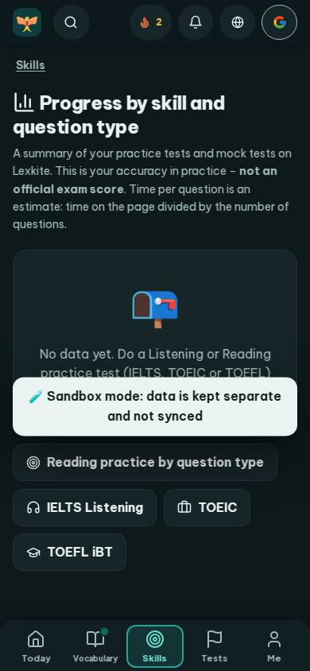
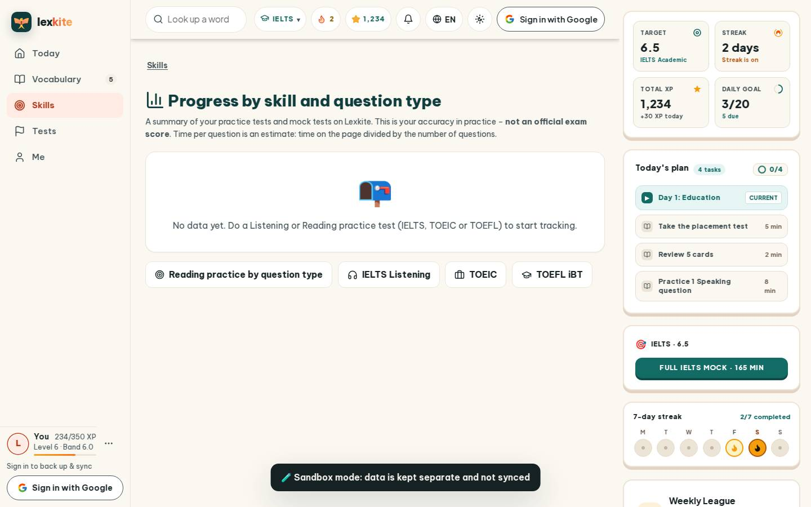
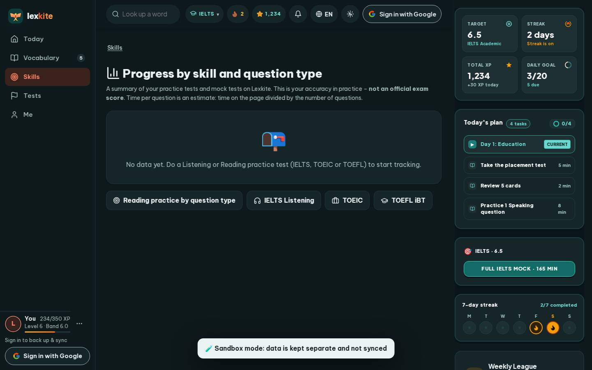

# #/qstats

Điểm: **93** · độ phủ 100 % · /qstats

- Chức năng: 100
- Lỗi JS: 100
- Rỗng/lỗi/tải: 100
- Back/Thoát: –
- Tương phản: 100
- Chạm ≥44: 100
- Bố cục: 100
- i18n 15: 100
- Hiệu năng: 61
- Độ đẹp: 75

## Lỗi
- [perf] LCP 5200 ms · CLS 0.0031 · TBT 3 ms
- [beauty] Dark toast notification obscures primary content and action buttons
- [beauty] Generic mailbox icon feels pasted on, not integrated
- [beauty] Uneven spacing between button groups and cards

## Ảnh
390l 
390d 
1440l 
1440d 
