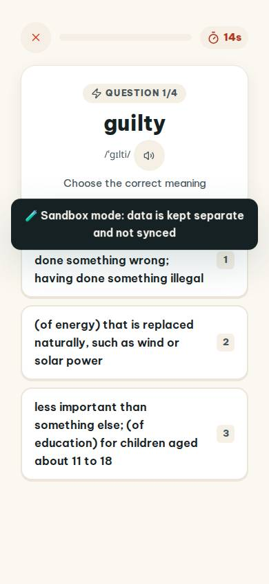
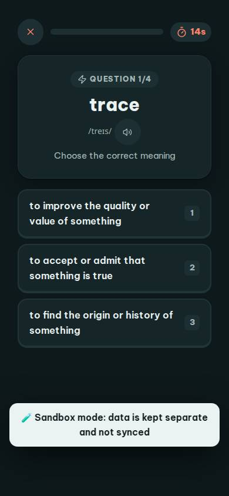
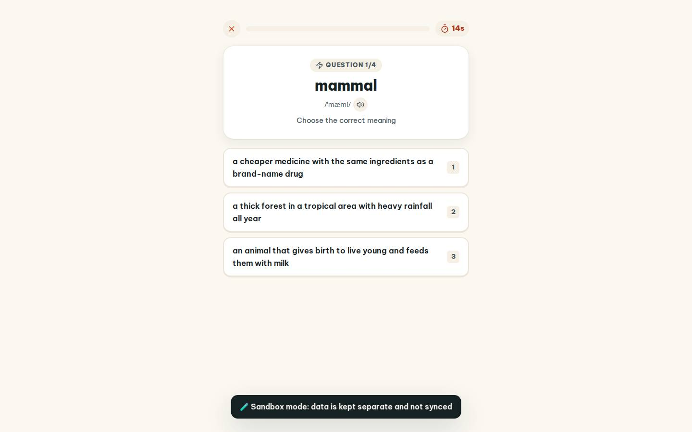
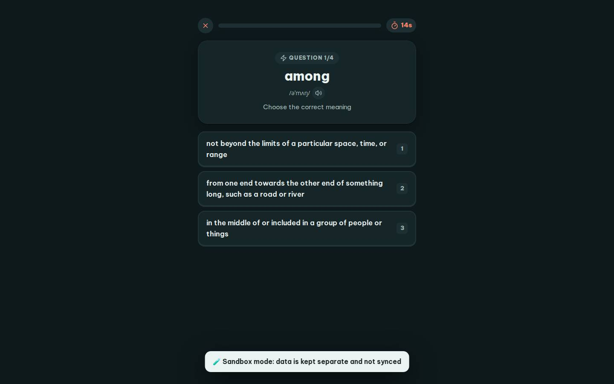

# #/quick

Điểm: **95** · độ phủ 100 % · /quick

- Chức năng: 100
- Lỗi JS: 100
- Rỗng/lỗi/tải: 100
- Back/Thoát: 100
- Tương phản: 100
- Chạm ≥44: 100
- Bố cục: 100
- i18n 15: 100
- Hiệu năng: 79
- Độ đẹp: 77

## Lỗi
- [perf] LCP 3984 ms · CLS 0.0001 · TBT 22 ms
- [beauty] Dark toast banner obscures primary answer option
- [beauty] No character or illustration integration
- [beauty] Generic card styling lacks Duolingo's playful polish

## Ảnh
390l 
390d 
1440l 
1440d 
