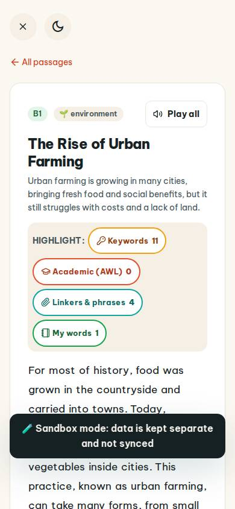
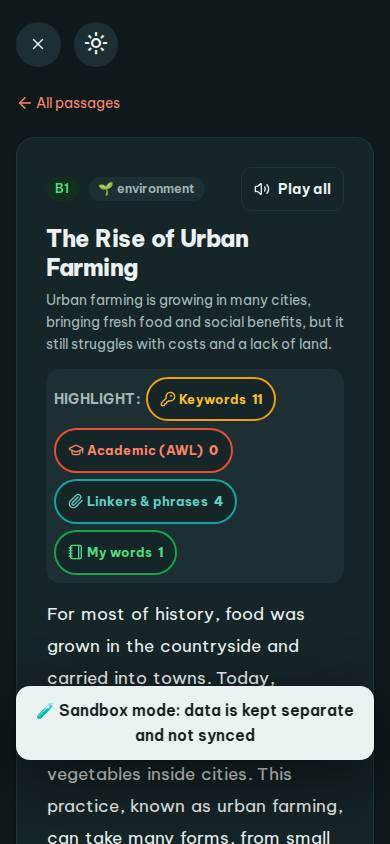
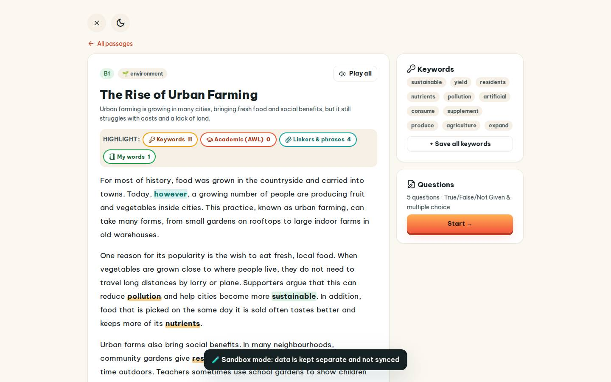
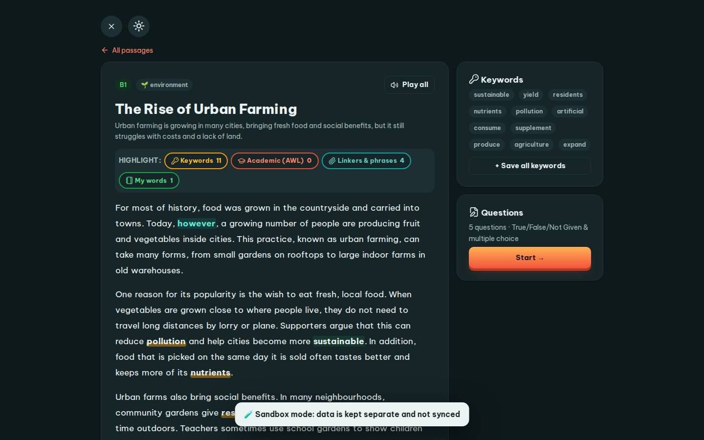

# #/read

Điểm: **78** · độ phủ 100 % · /read

- Chức năng: 100
- Lỗi JS: 100
- Rỗng/lỗi/tải: 100
- Back/Thoát: 100
- Tương phản: 100
- Chạm ≥44: 36
- Bố cục: 70
- i18n 15: 13
- Hiệu năng: 50
- Độ đẹp: 72

## Lỗi
- [tap] main#view>a.small – "All passages" vùng chạm 107×18 < 44px
- [tap] button#readAloud – "Play all" vùng chạm 103×36 < 44px
- [tap] div#hlBar>button.hl-chip.kw – "Keywords 11" vùng chạm 130×34 < 44px
- [tap] div#hlBar>button.hl-chip.awl – "Academic (AWL) 0" vùng chạm 179×34 < 44px
- [tap] div#hlBar>button.hl-chip.link – "Linkers & phrases 4" vùng chạm 183×34 < 44px
- [layout] div#hlBar>button.hl-chip.mine – "My words 1" rớt xuống đứng một mình ở dòng cuối của div#hlBar
- [layout] div.q-item>div.opts>button – "D. It uses too much electricity." rớt xuống đứng một mình ở dòng cuối của div#qs>div.q-item>div.opts
- [i18n] ar: thiếu dịch «For» · thiếu dịch «Today»
- [i18n] de: thiếu dịch «For» · thiếu dịch «Today»
- [i18n] es: thiếu dịch «For» · thiếu dịch «Today»
- [i18n] fr: thiếu dịch «For» · thiếu dịch «Today»
- [perf] LCP 6276 ms · CLS 0 · TBT 116 ms
- [beauty] Dark toast banner obscures body text
- [beauty] No clear primary action; 'Play all' is weak
- [beauty] Generic layout, lacks Duolingo character/illustration

## Ảnh
390l 
390d 
1440l 
1440d 
