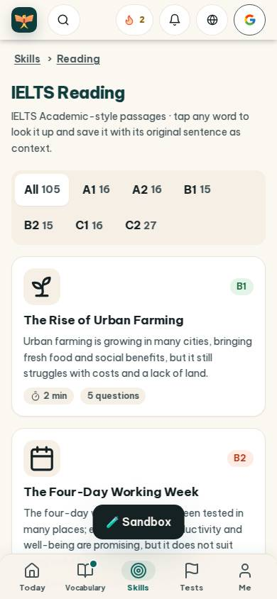
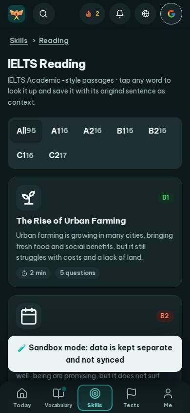
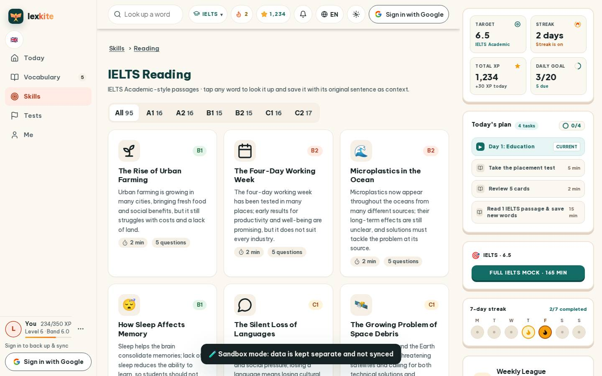
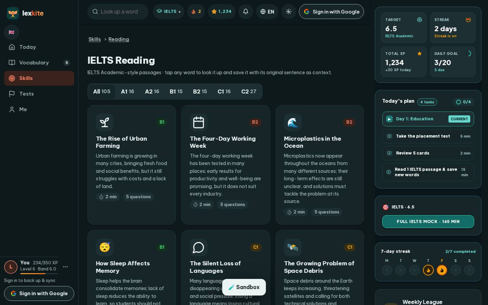

# #/reading

Điểm: **92** · độ phủ 100 % · /reading

- Chức năng: 100
- Lỗi JS: 100
- Rỗng/lỗi/tải: 100
- Back/Thoát: –
- Tương phản: 100
- Chạm ≥44: 92
- Bố cục: 100
- i18n 15: 100
- Hiệu năng: 50
- Độ đẹp: 83

## Lỗi
- [tap] main#view>div.tabs>a – "All 95" vùng chạm 70×39 < 44px
- [perf] LCP 6200 ms · CLS 0.0039 · TBT 110 ms
- [beauty] Dark toast notification obscures content and breaks visual flow
- [beauty] Top nav icons (search, bell, globe) feel generic and cluttered
- [beauty] Level filter chips lack clear visual hierarchy or active state

## Ảnh
390l 
390d 
1440l 
1440d 
