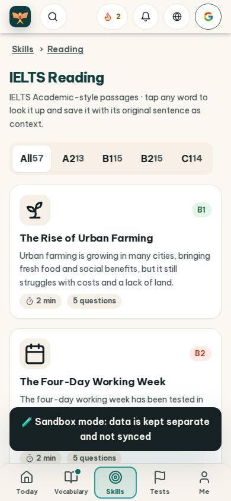
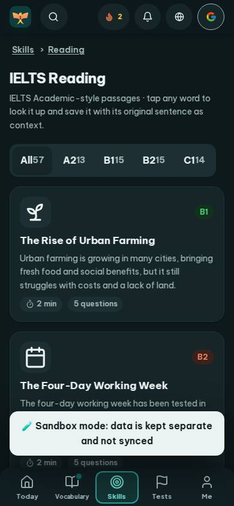
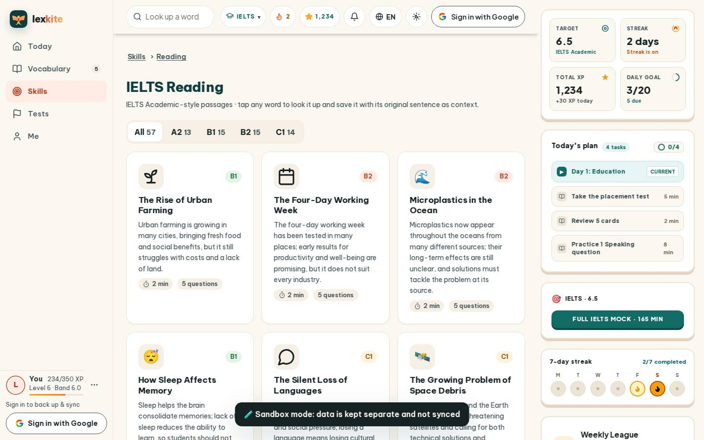
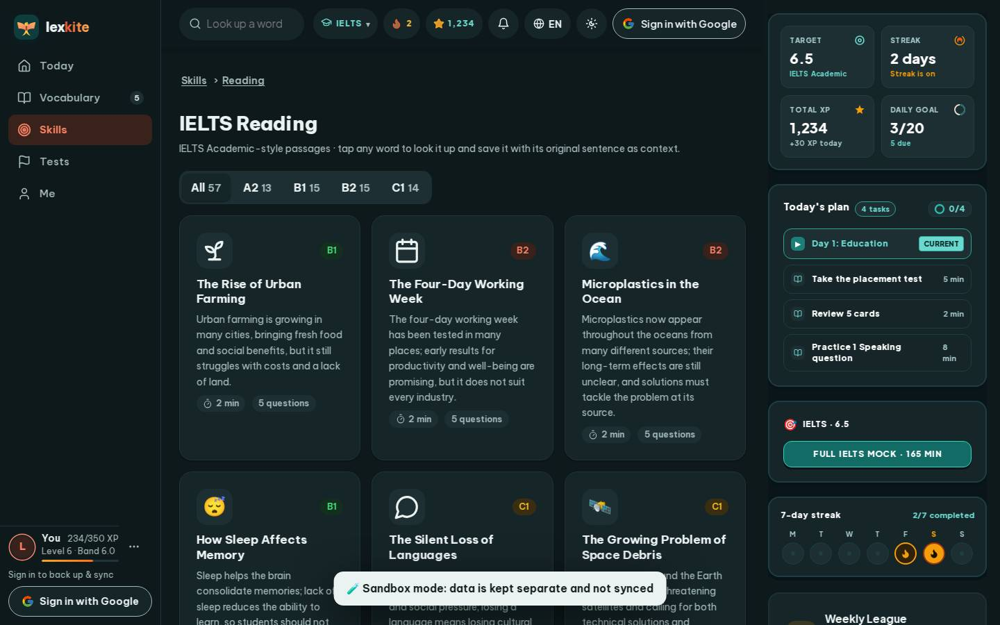

# #/reading

Điểm: **93** · độ phủ 100 % · /reading

- Chức năng: 100
- Lỗi JS: 100
- Rỗng/lỗi/tải: 100
- Back/Thoát: –
- Tương phản: 100
- Chạm ≥44: 92
- Bố cục: 100
- i18n 15: 100
- Hiệu năng: 50
- Độ đẹp: 84

## Lỗi
- [tap] main#view>div.tabs>a – "All 57" vùng chạm 70×39 < 44px
- [perf] LCP 6020 ms · CLS 0.0031 · TBT 107 ms
- [beauty] Dark toast notification obscures content and breaks visual flow
- [beauty] Top nav icons feel generic and lack Duolingo's playful character
- [beauty] Card icons are flat and lack the polished, integrated feel of top-tier apps

## Ảnh
390l 
390d 
1440l 
1440d 
