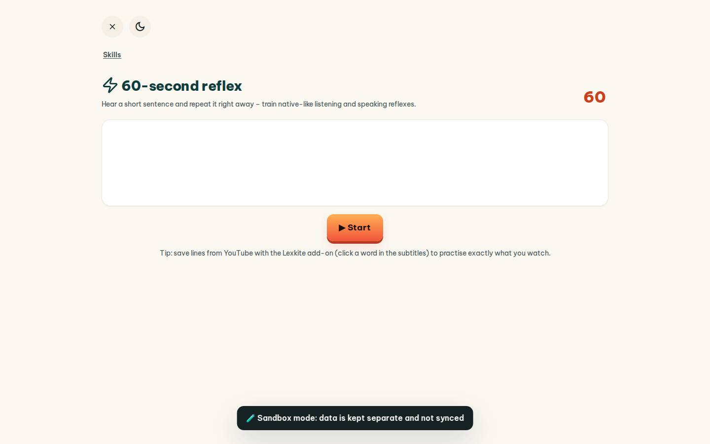
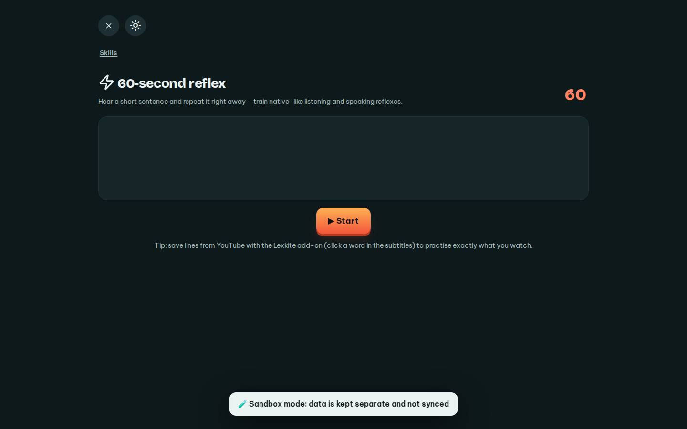

# #/reflex

Điểm: **92** · độ phủ 100 % · /reflex

- Chức năng: 100
- Lỗi JS: 100
- Rỗng/lỗi/tải: 100
- Back/Thoát: 100
- Tương phản: 100
- Chạm ≥44: 100
- Bố cục: 100
- i18n 15: 100
- Hiệu năng: 50
- Độ đẹp: 72

## Lỗi
- [perf] LCP 9140 ms · CLS 0 · TBT 96 ms
- [beauty] Large empty white card looks like a broken or loading placeholder
- [beauty] No illustration or character integration, feels generic
- [beauty] Dark 'Sandbox mode' banner is visually heavy and clutters the flow

## Ảnh
390l 
390d 
1440l 
1440d 
