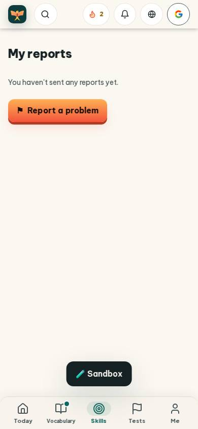
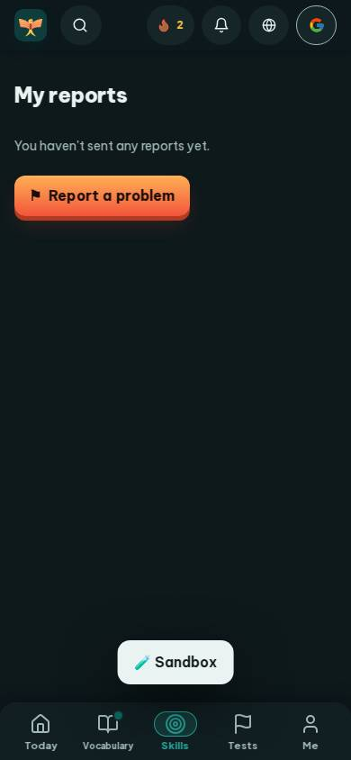
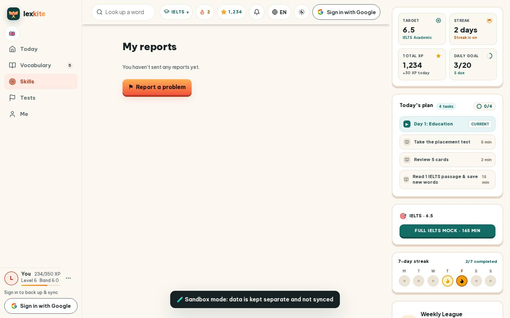
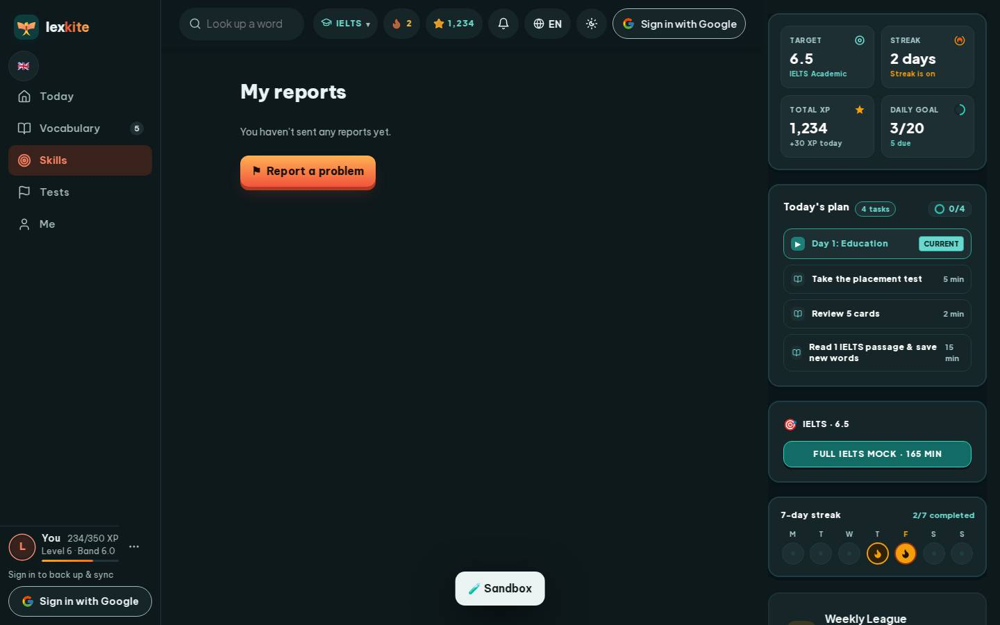

# #/report

Điểm: **95** · độ phủ 100 % · /report

- Chức năng: 100
- Lỗi JS: 100
- Rỗng/lỗi/tải: 100
- Back/Thoát: –
- Tương phản: 100
- Chạm ≥44: 100
- Bố cục: 100
- i18n 15: 100
- Hiệu năng: 86
- Độ đẹp: 72

## Lỗi
- [perf] LCP 3508 ms · CLS 0.0039 · TBT 37 ms
- [beauty] Excessive empty whitespace makes the screen feel unfinished and sparse.
- [beauty] Sandbox mode banner looks like a raw debug overlay, not a polished UI element.
- [beauty] Generic orange button lacks the playful, character-driven polish of Duolingo.

## Ảnh
390l 
390d 
1440l 
1440d 
