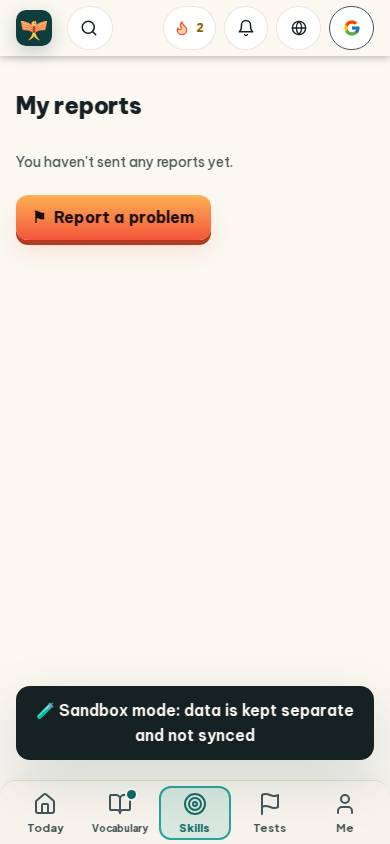
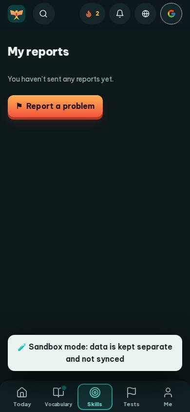
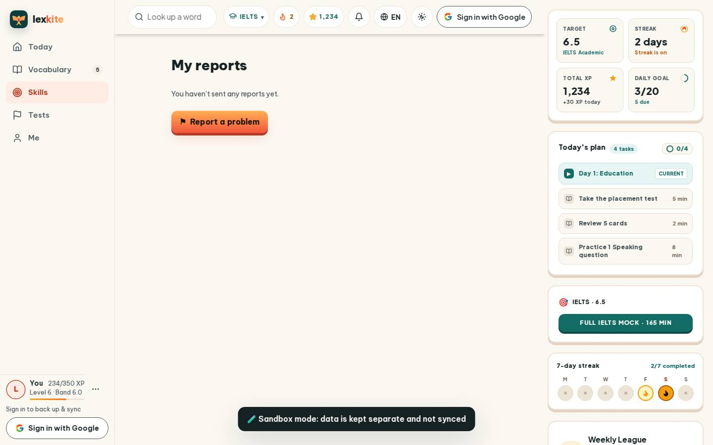
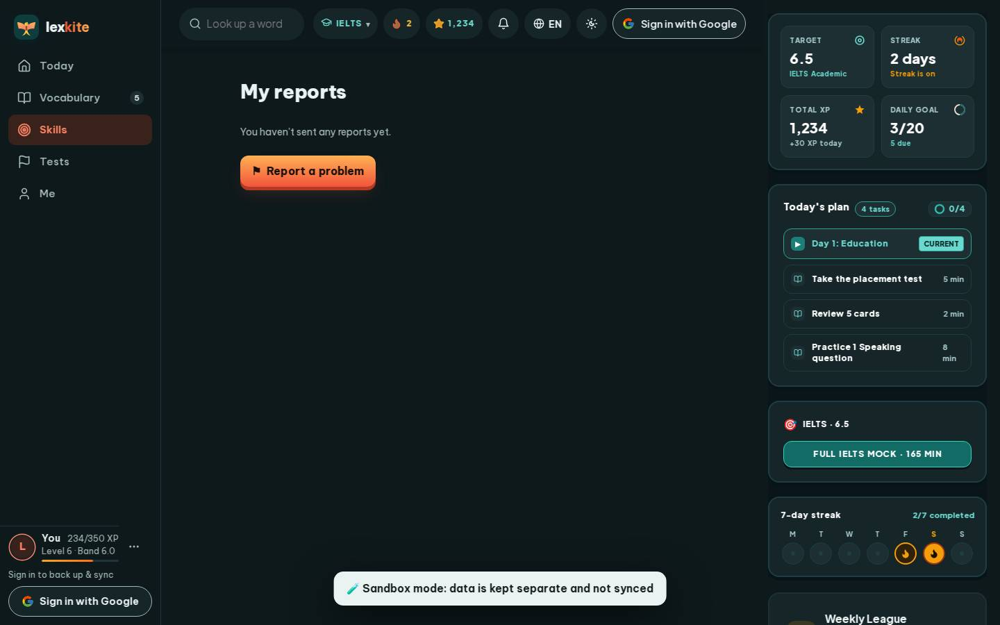

# #/report

Điểm: **93** · độ phủ 100 % · /report

- Chức năng: 100
- Lỗi JS: 100
- Rỗng/lỗi/tải: 100
- Back/Thoát: –
- Tương phản: 90
- Chạm ≥44: 100
- Bố cục: 100
- i18n 15: 100
- Hiệu năng: 75
- Độ đẹp: 72

## Lỗi
- [contrast] a[data-ext-cta="rail"]
- [perf] LCP 4220 ms · CLS 0.0031 · TBT 53 ms
- [beauty] Empty state lacks illustration or character, feels barren
- [beauty] Sandbox mode banner looks like a debug toast, not polished UI
- [beauty] Top nav icons are generic and inconsistent in style

## Ảnh
390l 
390d 
1440l 
1440d 
