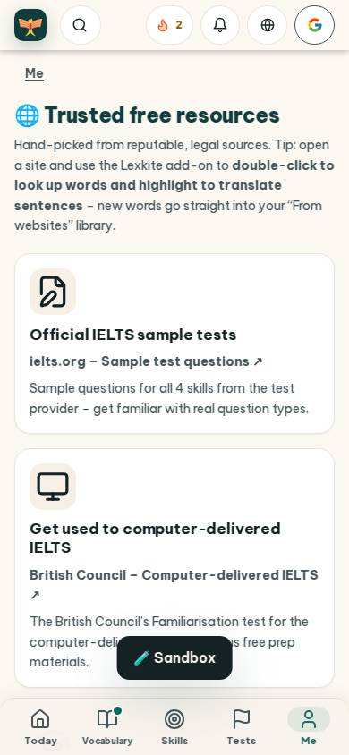
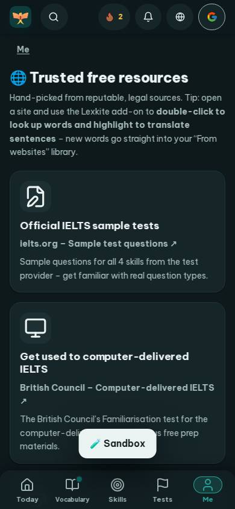
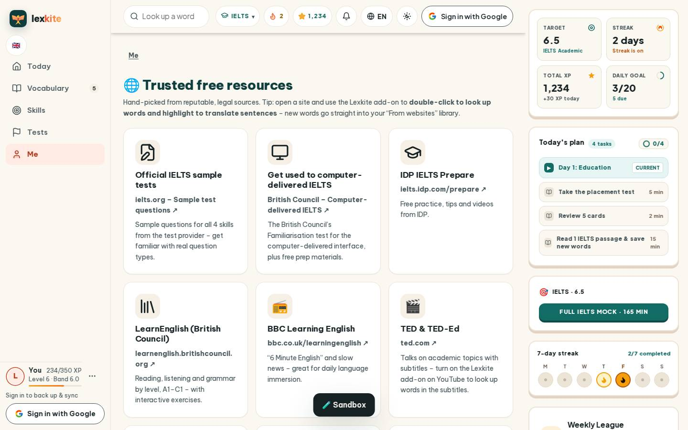
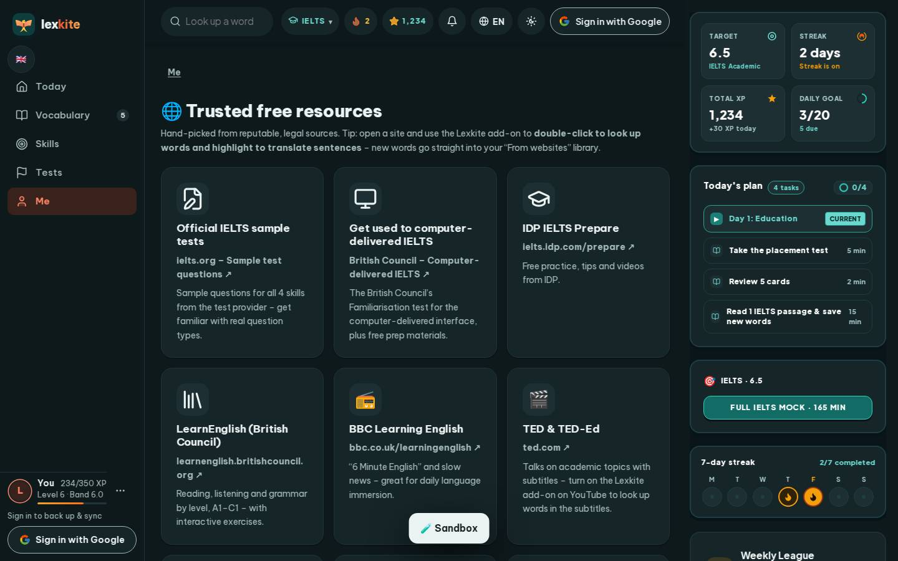

# #/resources

Điểm: **93** · độ phủ 100 % · /resources

- Chức năng: 100
- Lỗi JS: 100
- Rỗng/lỗi/tải: 100
- Back/Thoát: –
- Tương phản: 100
- Chạm ≥44: 100
- Bố cục: 100
- i18n 15: 100
- Hiệu năng: 57
- Độ đẹp: 77

## Lỗi
- [perf] LCP 5544 ms · CLS 0.0038 · TBT 159 ms
- [beauty] Generic line icons lack Duolingo's playful character integration
- [beauty] Dense paragraph text reduces visual hierarchy and scannability
- [beauty] Flat beige background feels less polished than Duolingo's vibrant palette

## Ảnh
390l 
390d 
1440l 
1440d 
