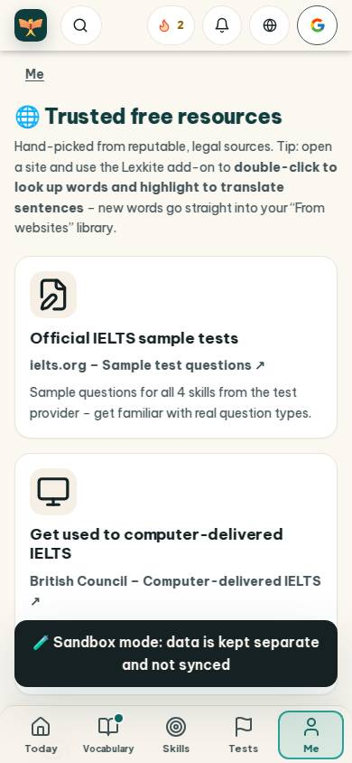
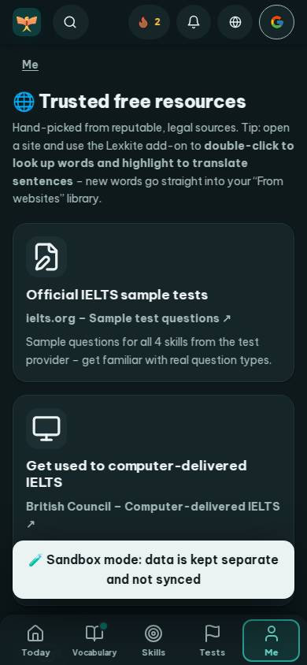
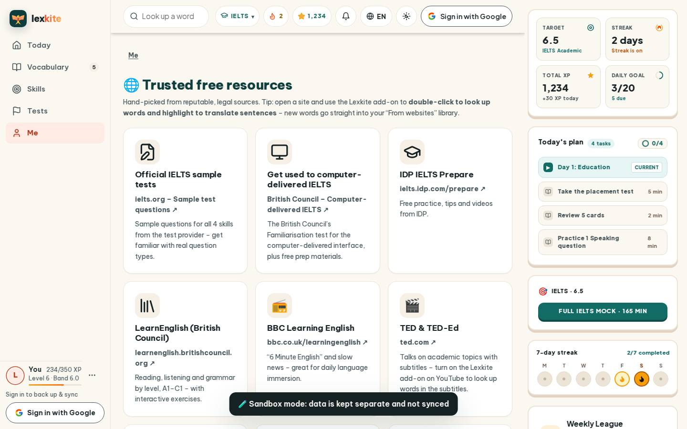
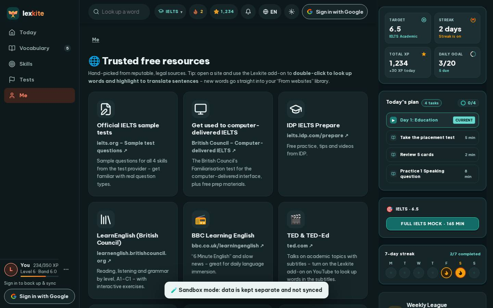

# #/resources

Điểm: **94** · độ phủ 100 % · /resources

- Chức năng: 100
- Lỗi JS: 100
- Rỗng/lỗi/tải: 100
- Back/Thoát: –
- Tương phản: 100
- Chạm ≥44: 100
- Bố cục: 100
- i18n 15: 100
- Hiệu năng: 63
- Độ đẹp: 81

## Lỗi
- [perf] LCP 5064 ms · CLS 0.0031 · TBT 0 ms
- [beauty] Generic line icons lack Duolingo's playful character polish
- [beauty] Dense paragraph text reduces scannable visual hierarchy
- [beauty] Sandbox banner feels like a raw toast, not integrated UI

## Ảnh
390l 
390d 
1440l 
1440d 
