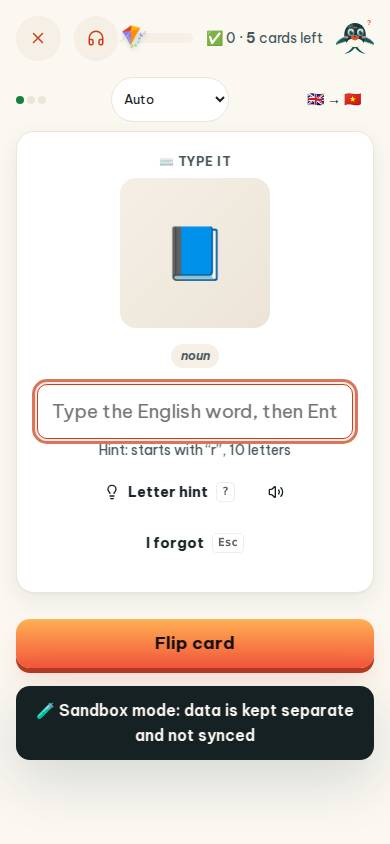
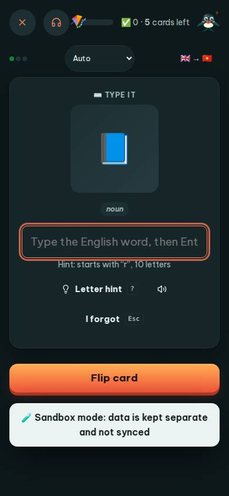
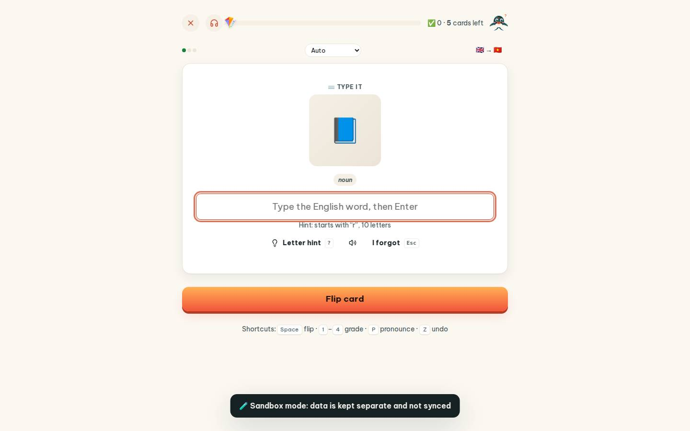
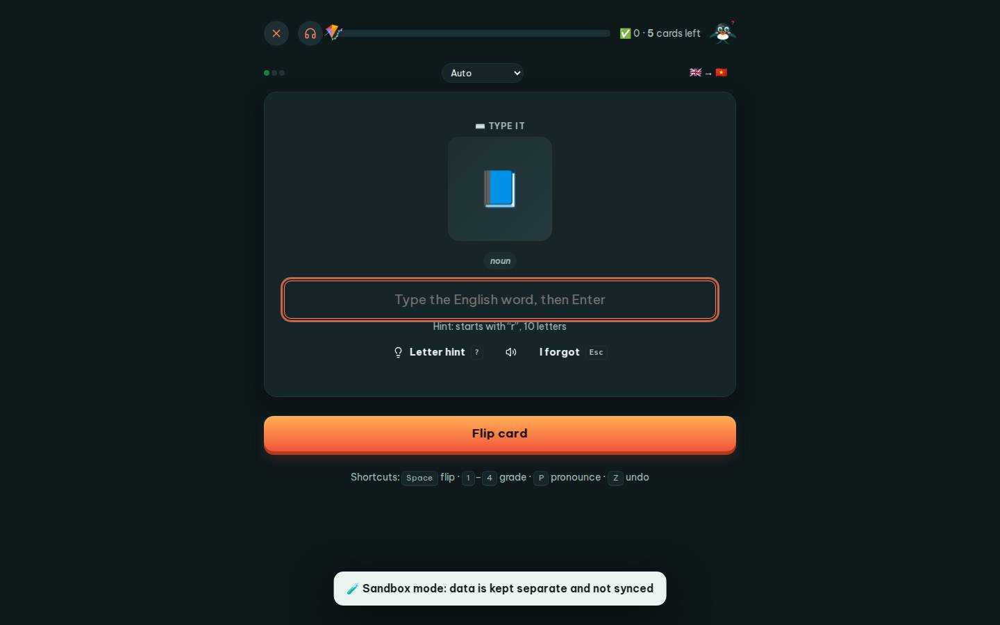

# #/review

Điểm: **84** · độ phủ 100 % · /review

- Chức năng: 100
- Lỗi JS: 100
- Rỗng/lỗi/tải: 100
- Back/Thoát: 100
- Tương phản: 100
- Chạm ≥44: 60
- Bố cục: 100
- i18n 15: 13
- Hiệu năng: 72
- Độ đẹp: 72

## Lỗi
- [tap] select#rmSel – "Auto Flip card Type it Listen & pick" vùng chạm 118×28 < 44px
- [tap] button#toggleRev – "🇬🇧 → 🇻🇳" vùng chạm 80×36 < 44px
- [tap] button#rmLet – "Letter hint ?" vùng chạm 156×36 < 44px
- [tap] button#rmHear – "Hear the word" vùng chạm 42×36 < 44px
- [tap] button#rmGive – "I forgot Esc" vùng chạm 124×36 < 44px
- [i18n] ar: thiếu dịch «noun»
- [i18n] de: thiếu dịch «noun»
- [i18n] es: thiếu dịch «noun»
- [i18n] fr: thiếu dịch «noun»
- [perf] LCP 4308 ms · CLS 0.0005 · TBT 265 ms
- [beauty] Generic flat book icon lacks Duolingo-style character polish
- [beauty] Top nav icons are small, faint, and unevenly spaced
- [beauty] Dark 'Sandbox mode' banner feels like a raw debug overlay

## Ảnh
390l 
390d 
1440l 
1440d 
