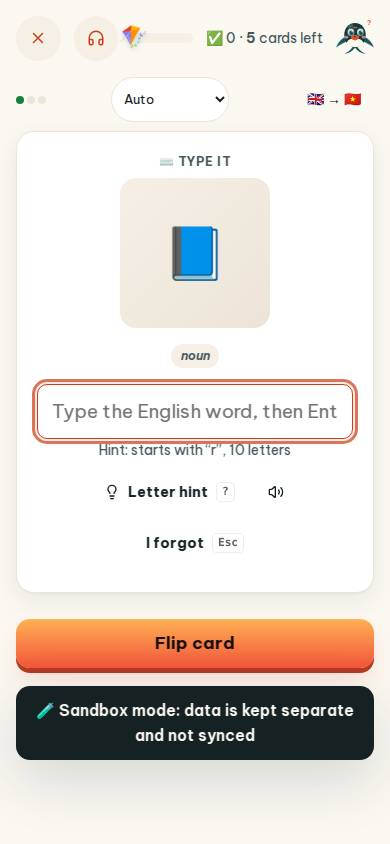
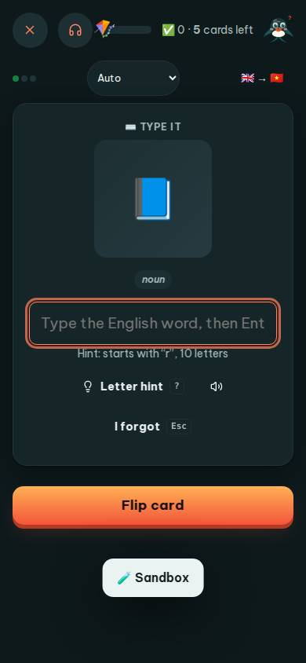
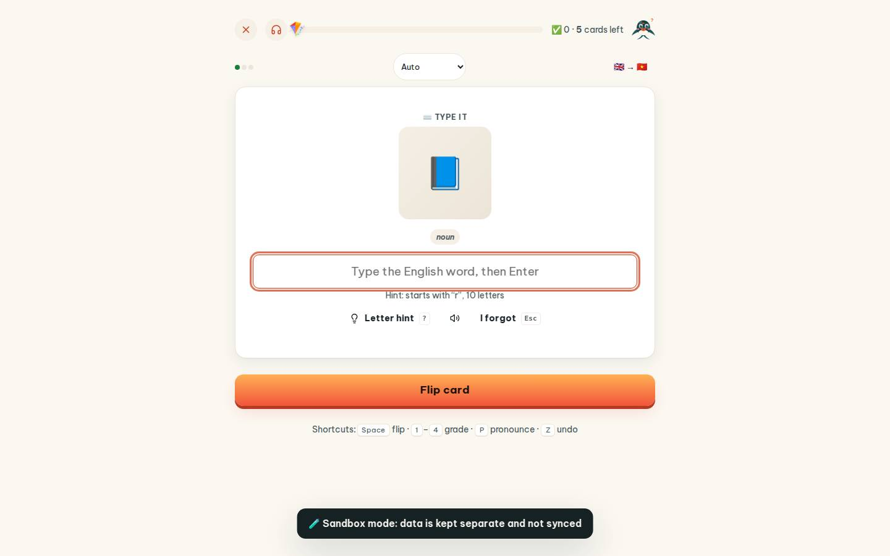
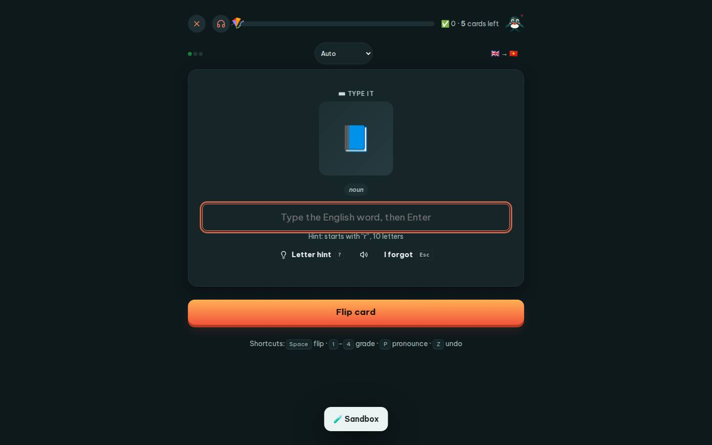

# #/review

Điểm: **85** · độ phủ 86 % · /review

- Chức năng: 100
- Lỗi JS: 100
- Rỗng/lỗi/tải: 100
- Back/Thoát: 100
- Tương phản: 100
- Chạm ≥44: 68
- Bố cục: 100
- i18n 15: 13
- Hiệu năng: 57
- Độ đẹp: ∅

## Lỗi
- [tap] button#toggleRev – "🇬🇧 → 🇻🇳" vùng chạm 80×36 < 44px
- [tap] button#rmLet – "Letter hint ?" vùng chạm 156×36 < 44px
- [tap] button#rmHear – "Hear the word" vùng chạm 42×36 < 44px
- [tap] button#rmGive – "I forgot Esc" vùng chạm 124×36 < 44px
- [i18n] ar: thiếu dịch «noun»
- [i18n] de: thiếu dịch «noun»
- [i18n] es: thiếu dịch «noun»
- [i18n] fr: thiếu dịch «noun»
- [perf] LCP 5500 ms · CLS 0.0005 · TBT 39 ms

## Ảnh
390l 
390d 
1440l 
1440d 
