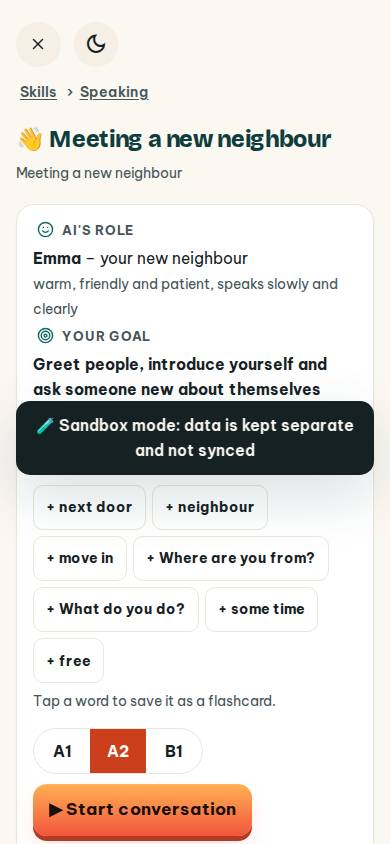
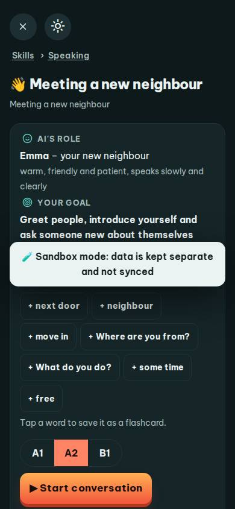
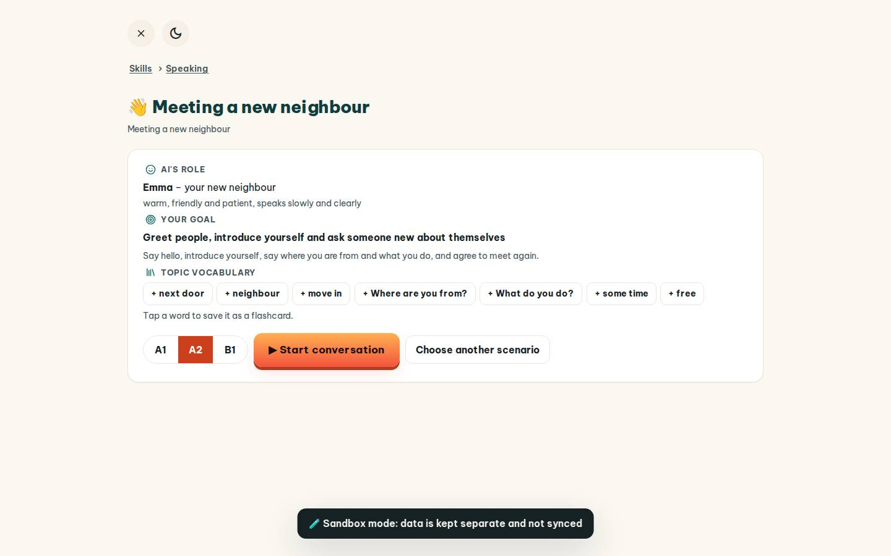
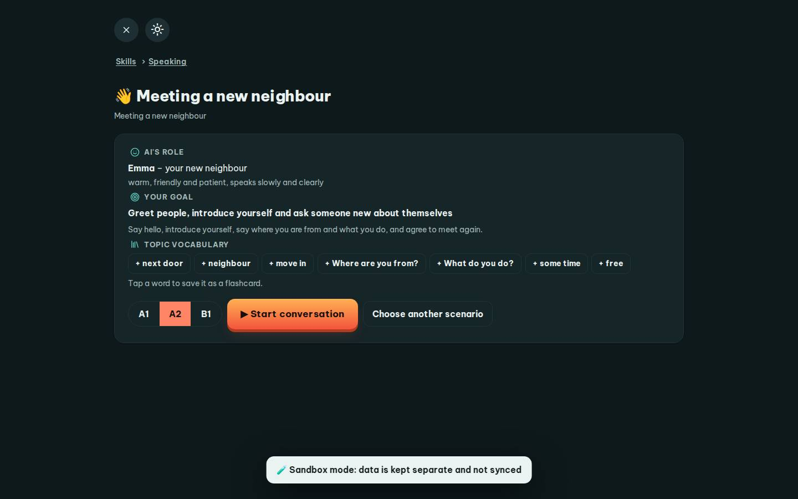

# #/roleplay

Điểm: **90** · độ phủ 100 % · /roleplay

- Chức năng: 100
- Lỗi JS: 100
- Rỗng/lỗi/tải: 100
- Back/Thoát: 100
- Tương phản: 100
- Chạm ≥44: 92
- Bố cục: 85
- i18n 15: 100
- Hiệu năng: 50
- Độ đẹp: 74

## Lỗi
- [tap] div.card>div.rp-chips>button.btn.sm – "+ next door" vùng chạm 113×36 < 44px
- [layout] div.card>div.rp-chips>button.btn.sm – "+ free" rớt xuống đứng một mình ở dòng cuối của main#view>div.card>div.rp-chips
- [perf] LCP 6112 ms · CLS 0 · TBT 98 ms
- [beauty] Generic system font lacks Duolingo's playful character
- [beauty] Tag chips feel like raw HTML buttons, low polish
- [beauty] Dark banner clashes with light, friendly palette

## Ảnh
390l 
390d 
1440l 
1440d 
