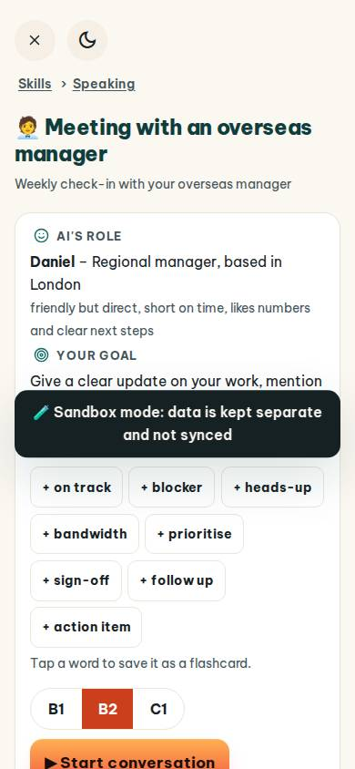
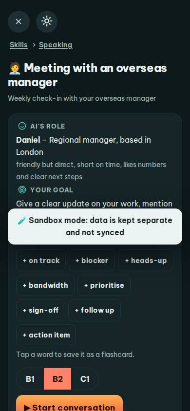
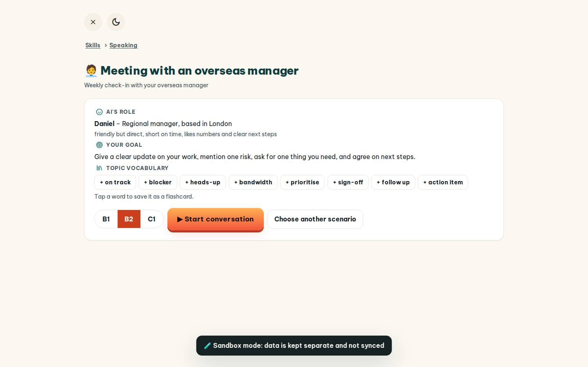
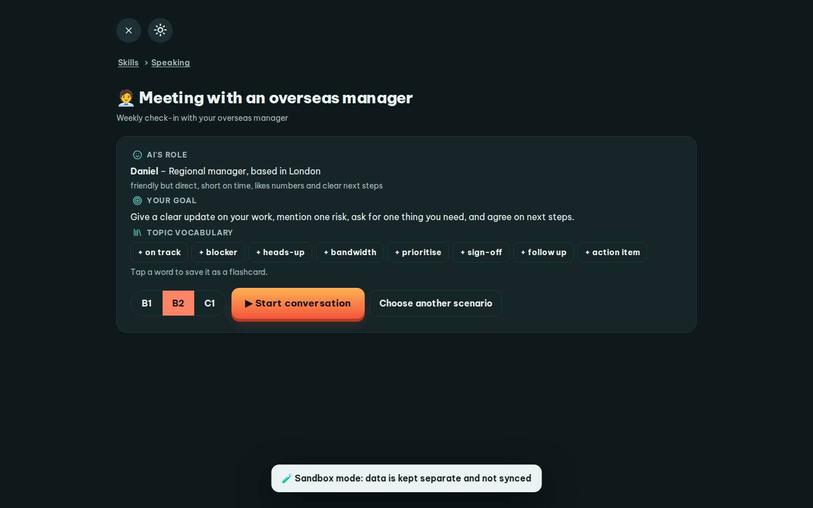

# #/roleplay/manager

Điểm: **92** · độ phủ 100 % · /roleplay/manager

- Chức năng: 100
- Lỗi JS: 100
- Rỗng/lỗi/tải: 100
- Back/Thoát: 100
- Tương phản: 100
- Chạm ≥44: 92
- Bố cục: 100
- i18n 15: 100
- Hiệu năng: 51
- Độ đẹp: 75

## Lỗi
- [tap] div.card>div.rp-chips>button.btn.sm – "+ on track" vùng chạm 102×36 < 44px
- [perf] LCP 5936 ms · CLS 0 · TBT 46 ms
- [beauty] Dark 'Sandbox mode' banner feels like a debug overlay, not polished UI.
- [beauty] Tag chips are plain and generic, lacking Duolingo's playful polish.
- [beauty] Layout is text-heavy and utilitarian; weak visual hierarchy and character integration.

## Ảnh
390l 
390d 
1440l 
1440d 
