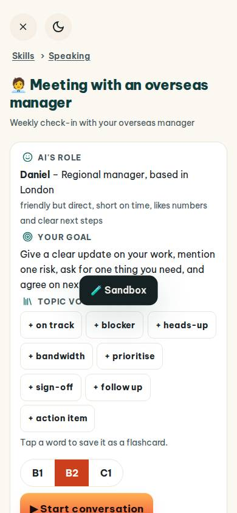
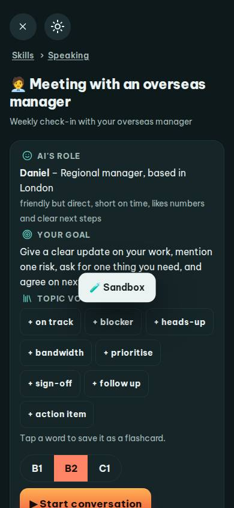
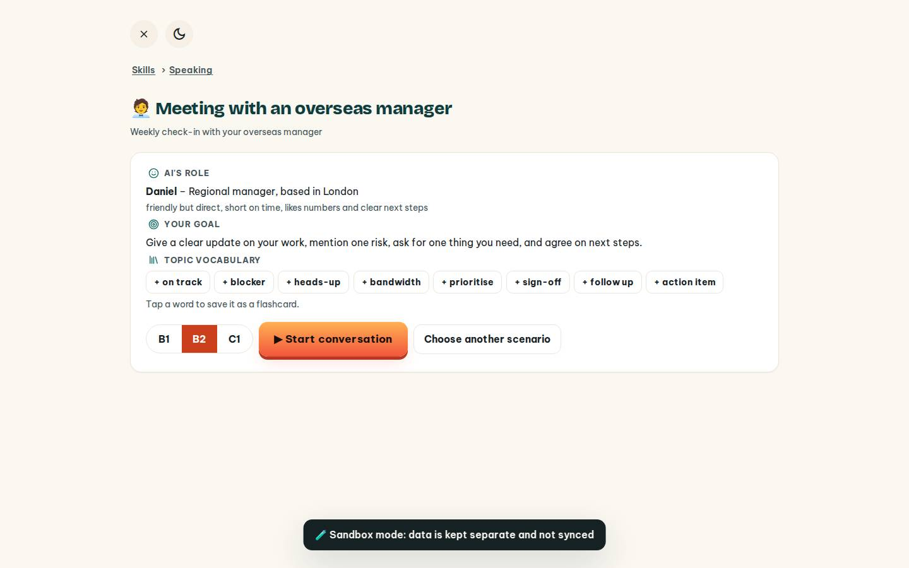
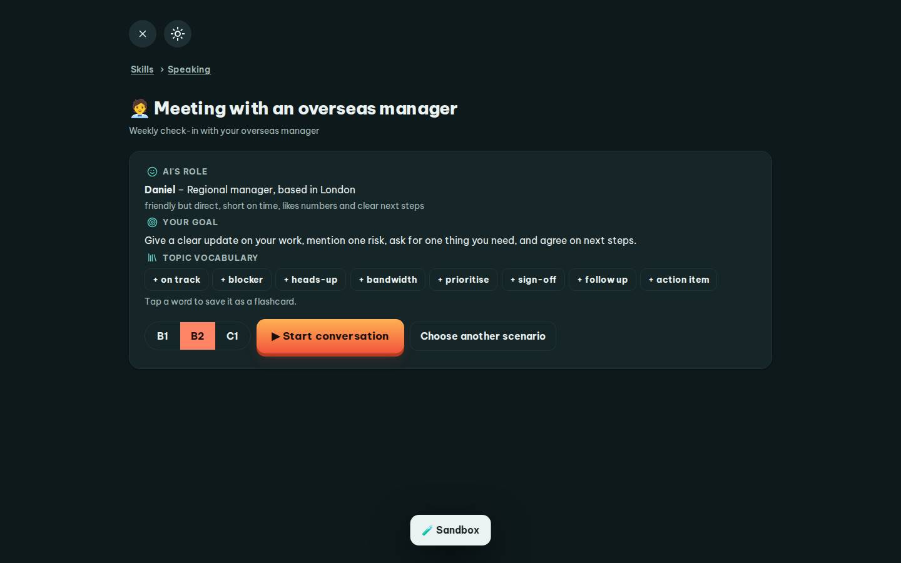

# #/roleplay/manager

Điểm: **92** · độ phủ 100 % · /roleplay/manager

- Chức năng: 100
- Lỗi JS: 100
- Rỗng/lỗi/tải: 100
- Back/Thoát: 100
- Tương phản: 100
- Chạm ≥44: 92
- Bố cục: 100
- i18n 15: 100
- Hiệu năng: 50
- Độ đẹp: 76

## Lỗi
- [tap] div.card>div.rp-chips>button.btn.sm – "+ on track" vùng chạm 102×36 < 44px
- [perf] LCP 6480 ms · CLS 0.0007 · TBT 51 ms
- [beauty] Generic pill chips look like default HTML, not Duolingo-style cards
- [beauty] Sandbox banner is a heavy dark block that breaks the light, friendly palette
- [beauty] No character/illustration integration; avatar is a tiny pasted emoji

## Ảnh
390l 
390d 
1440l 
1440d 
