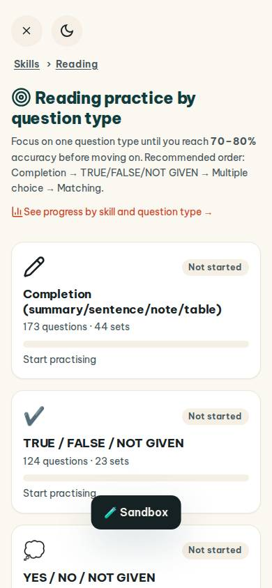
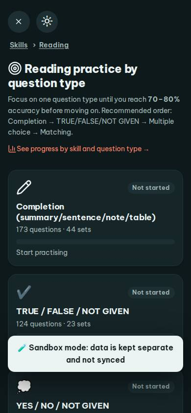
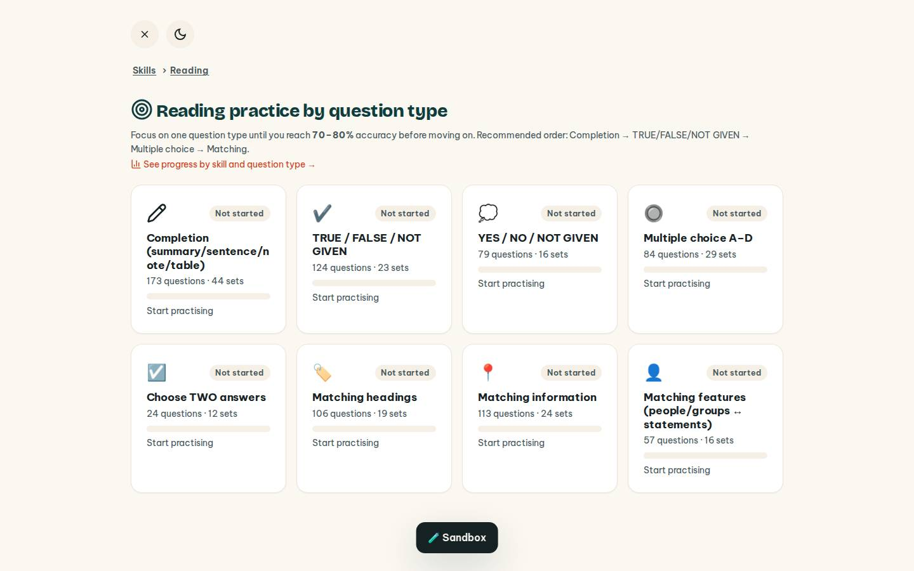
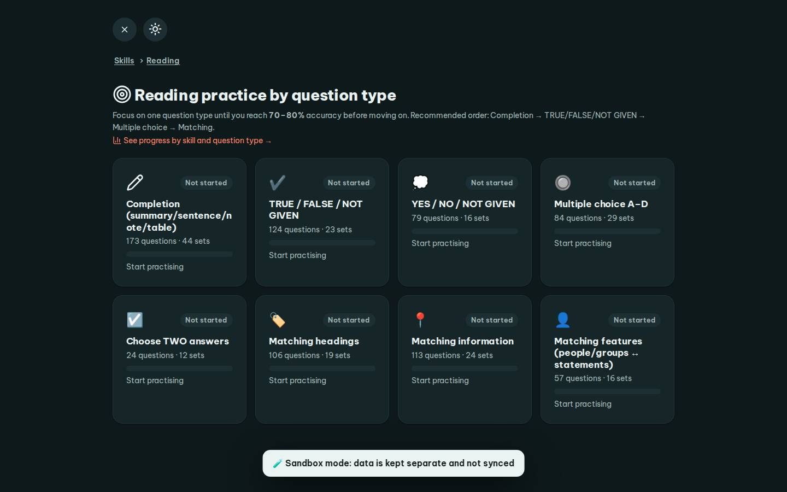

# #/rtype

Điểm: **92** · độ phủ 100 % · /rtype

- Chức năng: 100
- Lỗi JS: 100
- Rỗng/lỗi/tải: 100
- Back/Thoát: 100
- Tương phản: 100
- Chạm ≥44: 92
- Bố cục: 100
- i18n 15: 100
- Hiệu năng: 50
- Độ đẹp: 75

## Lỗi
- [tap] div.page-head>div>a.small – "See progress by skill and question type " vùng chạm 293×18 < 44px
- [perf] LCP 9180 ms · CLS 0.0007 · TBT 136 ms
- [beauty] No clear primary action; 'Start practising' is a plain text link, not a button.
- [beauty] Dark 'Sandbox mode' toast overlaps and obscures the list, creating visual clutter.
- [beauty] Generic, flat icons and lack of character/illustration feel less polished than Duolingo.

## Ảnh
390l 
390d 
1440l 
1440d 
