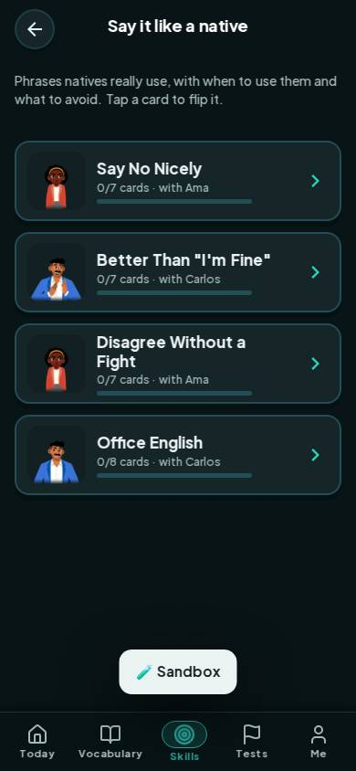
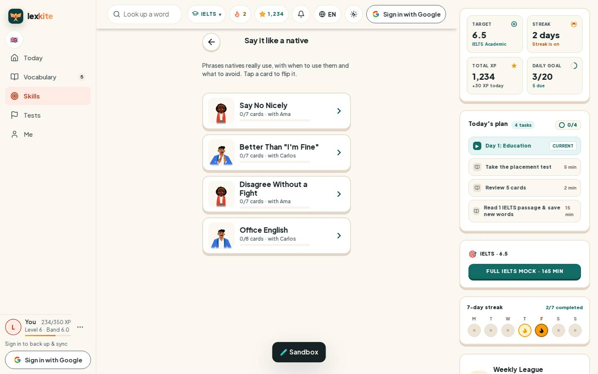

# #/say

Điểm: **92** · độ phủ 100 % · /say

- Chức năng: 100
- Lỗi JS: 100
- Rỗng/lỗi/tải: 100
- Back/Thoát: –
- Tương phản: 100
- Chạm ≥44: 100
- Bố cục: 100
- i18n 15: 100
- Hiệu năng: 50
- Độ đẹp: 79

## Lỗi
- [perf] LCP 8264 ms · CLS 0.0007 · TBT 112 ms
- [beauty] Character avatars look like flat stickers, not integrated illustrations
- [beauty] Dark sandbox banner feels visually heavy and disconnected
- [beauty] Truncated title 'Disagree Without a Fig...' looks unfinished

## Ảnh
390l 
390d 
1440l 
1440d 
