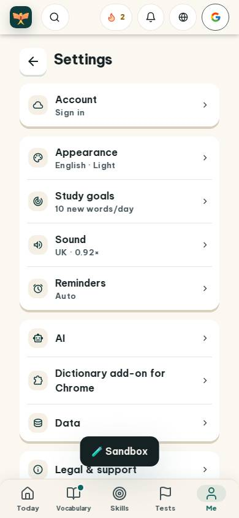
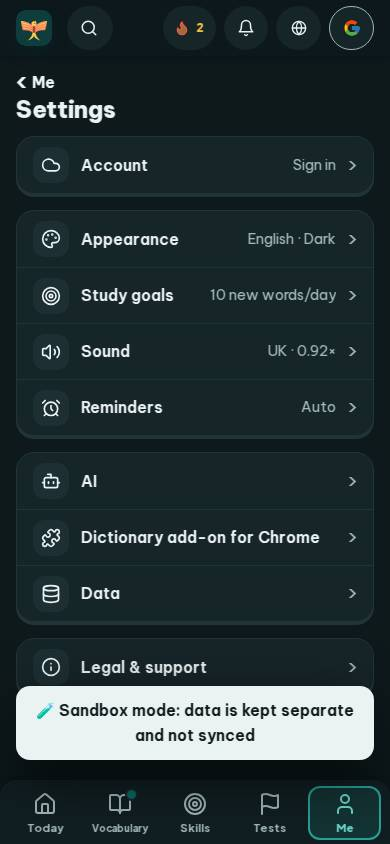
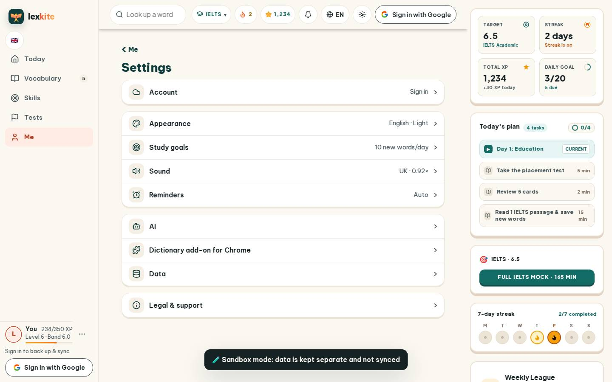
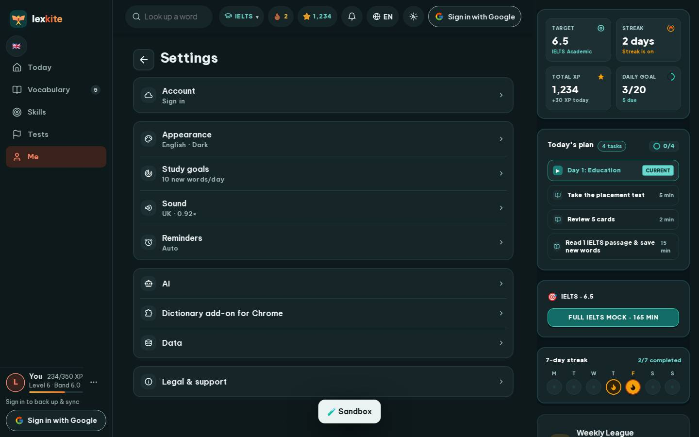

# #/settings

Điểm: **97** · độ phủ 100 % · /settings

- Chức năng: 100
- Lỗi JS: 100
- Rỗng/lỗi/tải: 100
- Back/Thoát: –
- Tương phản: 100
- Chạm ≥44: 100
- Bố cục: 100
- i18n 15: 100
- Hiệu năng: 85
- Độ đẹp: 86

## Lỗi
- [perf] LCP 3572 ms · CLS 0.0039 · TBT 78 ms
- [beauty] Top nav icons feel cramped and unevenly spaced
- [beauty] Sandbox banner overlaps content, reducing clarity
- [beauty] Generic list layout lacks Duolingo's playful character integration

## Ảnh
390l 
390d 
1440l 
1440d 
