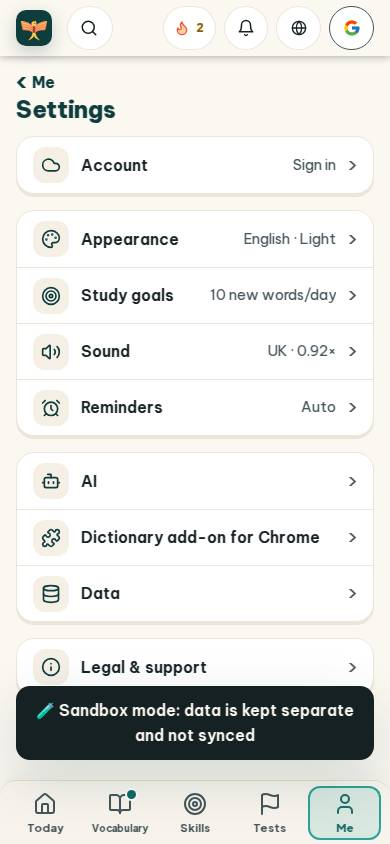
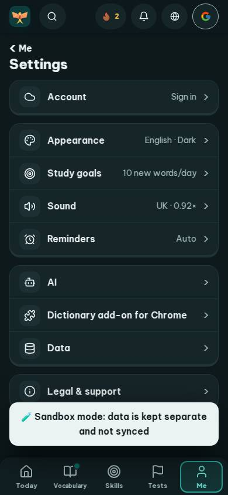
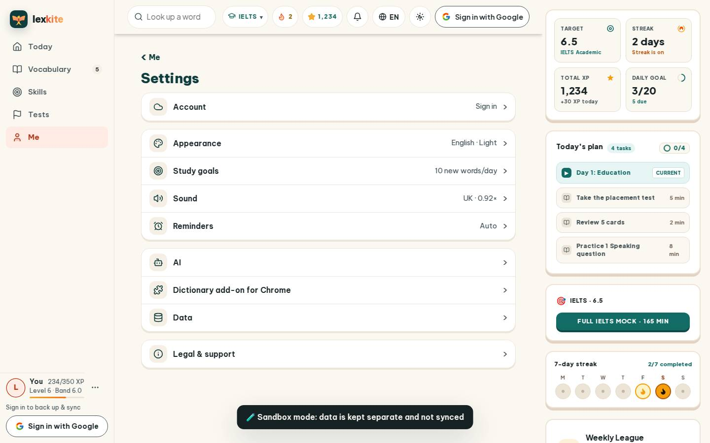
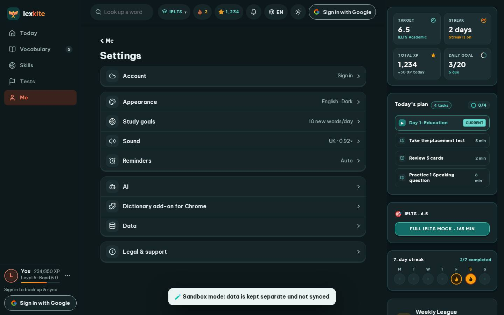

# #/settings

Điểm: **96** · độ phủ 100 % · /settings

- Chức năng: 100
- Lỗi JS: 100
- Rỗng/lỗi/tải: 100
- Back/Thoát: –
- Tương phản: 100
- Chạm ≥44: 100
- Bố cục: 100
- i18n 15: 100
- Hiệu năng: 79
- Độ đẹp: 86

## Lỗi
- [perf] LCP 3964 ms · CLS 0.0031 · TBT 29 ms
- [beauty] Top navigation bar feels crowded and cluttered.
- [beauty] Sandbox mode banner is visually heavy and dark.
- [beauty] Lacks the playful, character-driven illustration style of Duolingo.

## Ảnh
390l 
390d 
1440l 
1440d 
