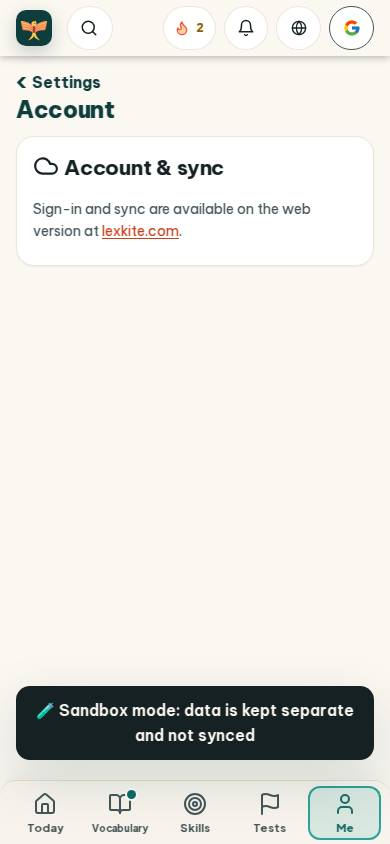
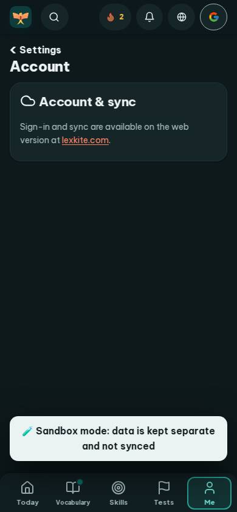
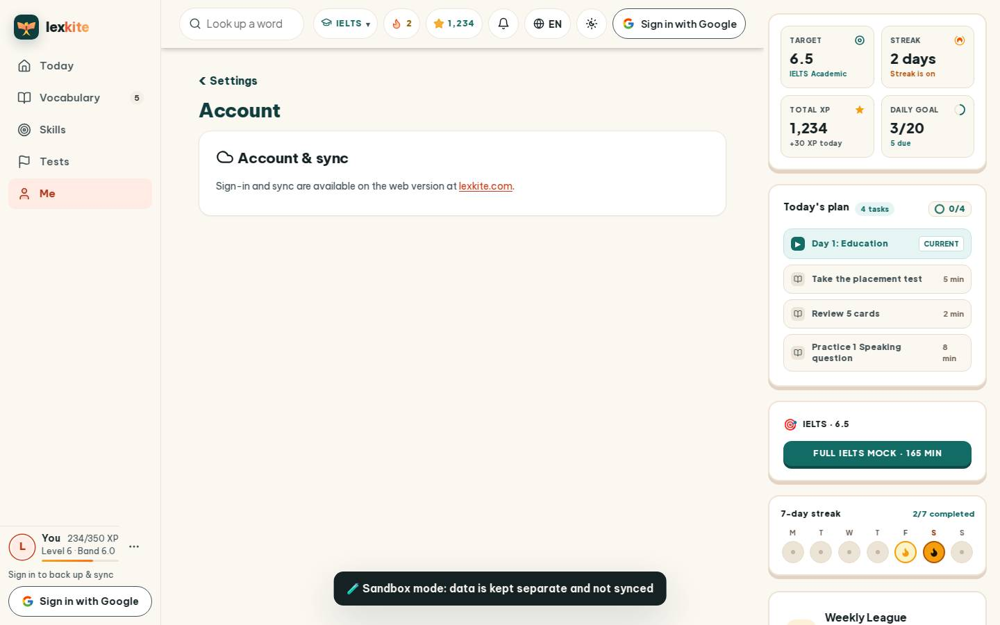
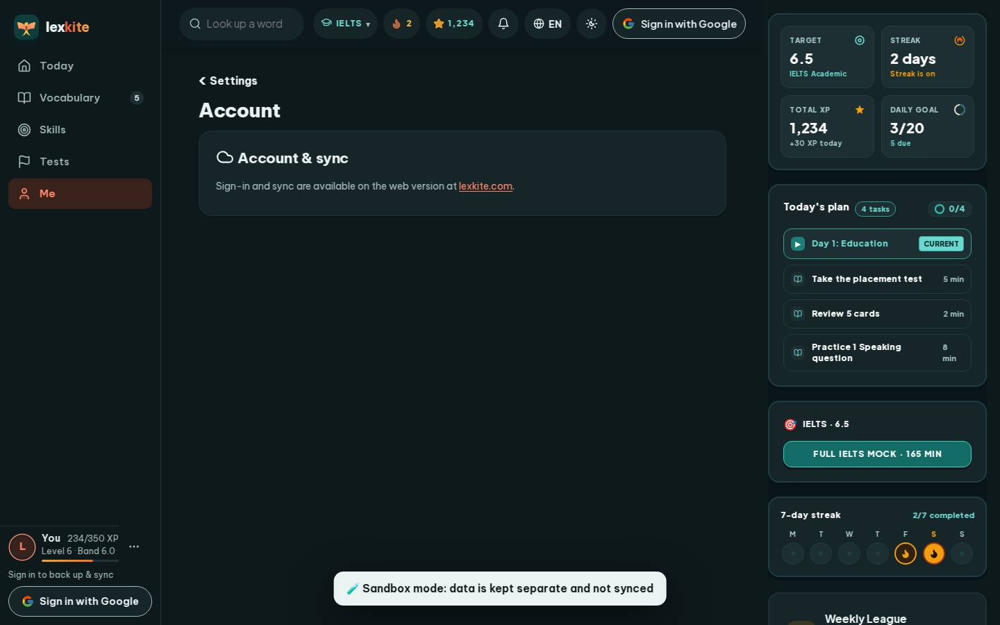

# #/settings/account

Điểm: **94** · độ phủ 100 % · /settings/account

- Chức năng: 100
- Lỗi JS: 100
- Rỗng/lỗi/tải: 100
- Back/Thoát: –
- Tương phản: 100
- Chạm ≥44: 100
- Bố cục: 100
- i18n 15: 100
- Hiệu năng: 78
- Độ đẹp: 74

## Lỗi
- [perf] LCP 4040 ms · CLS 0.0031 · TBT 45 ms
- [beauty] Large empty void between the single card and the bottom banner.
- [beauty] Sandbox mode banner looks like a raw debug toast, not a polished UI element.
- [beauty] No clear primary action; the screen is just a static info card.

## Ảnh
390l 
390d 
1440l 
1440d 
