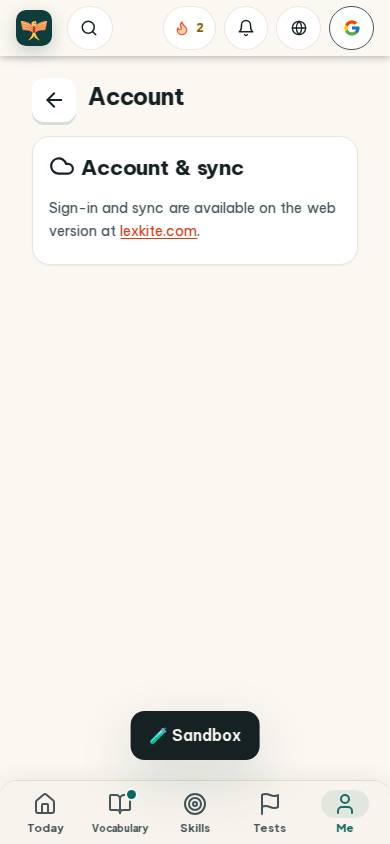
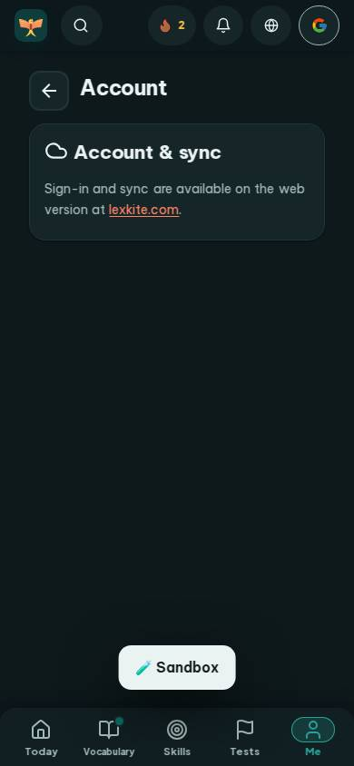
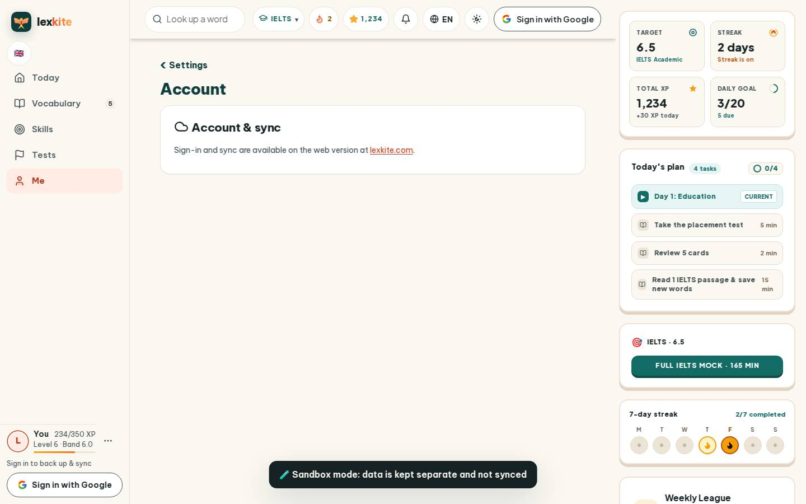
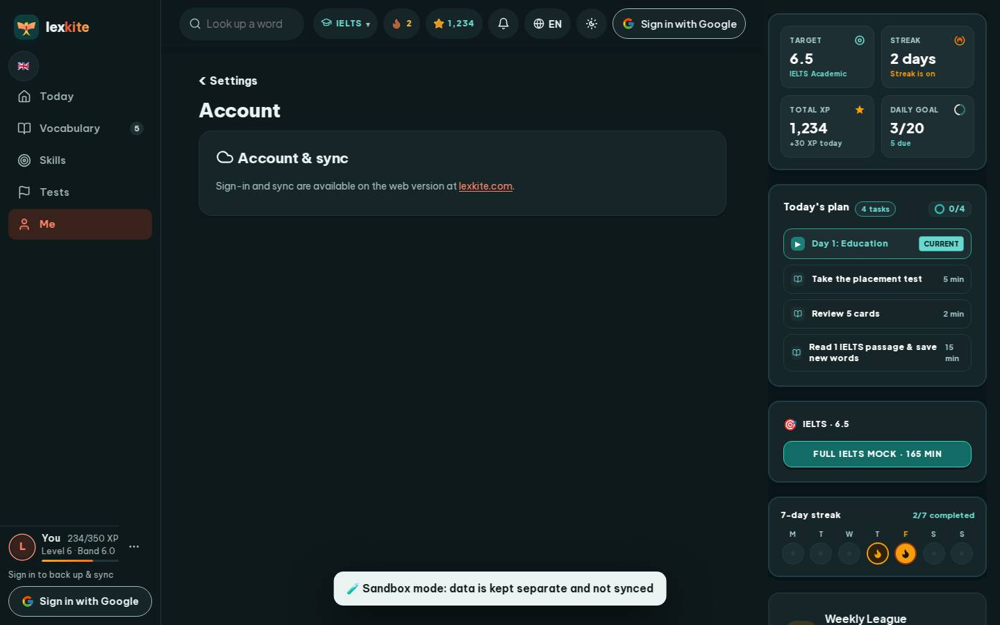

# #/settings/account

Điểm: **94** · độ phủ 100 % · /settings/account

- Chức năng: 100
- Lỗi JS: 100
- Rỗng/lỗi/tải: 100
- Back/Thoát: –
- Tương phản: 100
- Chạm ≥44: 100
- Bố cục: 100
- i18n 15: 100
- Hiệu năng: 82
- Độ đẹp: 72

## Lỗi
- [perf] LCP 3772 ms · CLS 0.0039 · TBT 113 ms
- [beauty] Excessive empty whitespace in the main content area.
- [beauty] Sandbox mode banner feels like a raw debug overlay.
- [beauty] Lacks the vibrant, character-driven polish of Duolingo.

## Ảnh
390l 
390d 
1440l 
1440d 
