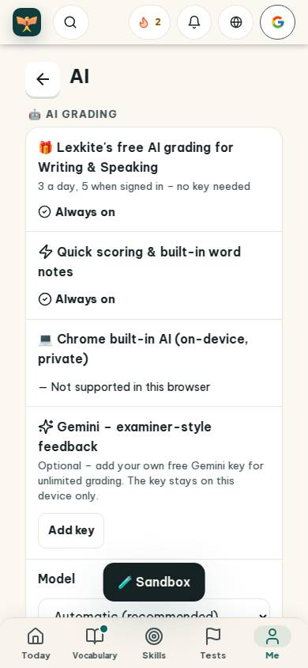
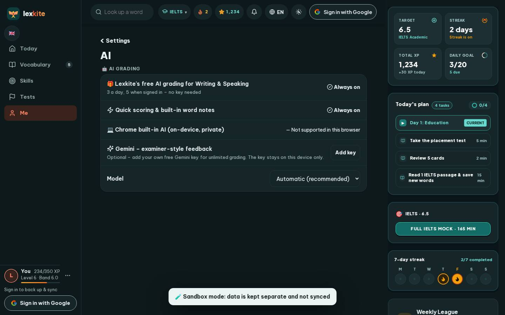

# #/settings/ai

Điểm: **93** · độ phủ 100 % · /settings/ai

- Chức năng: 100
- Lỗi JS: 100
- Rỗng/lỗi/tải: 100
- Back/Thoát: –
- Tương phản: 100
- Chạm ≥44: 100
- Bố cục: 100
- i18n 15: 100
- Hiệu năng: 57
- Độ đẹp: 77

## Lỗi
- [perf] LCP 5500 ms · CLS 0.0039 · TBT 51 ms
- [beauty] Dark toast notification obscures the 'Model' section content at the bottom.
- [beauty] Generic system icons and standard buttons lack the custom playful polish of Duolingo.
- [beauty] Visual hierarchy is flat; primary actions are not clearly distinguished from secondary text.

## Ảnh
390l 
390d 
1440l 
1440d 
