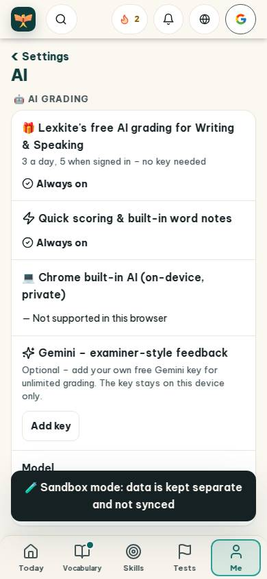
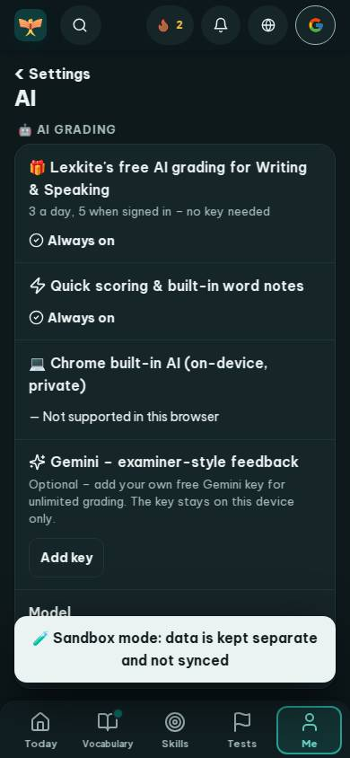
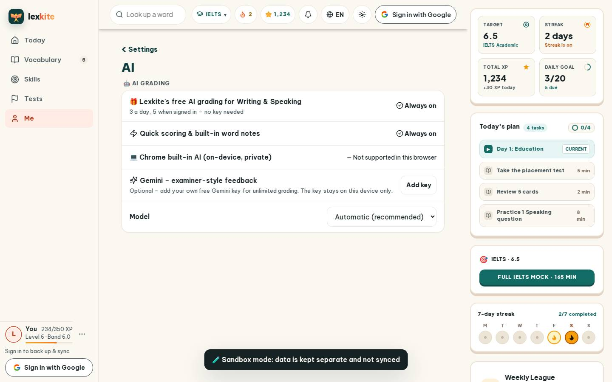
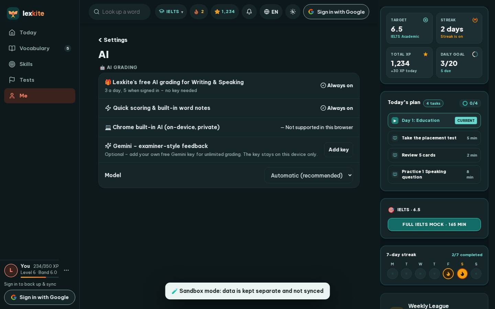

# #/settings/ai

Điểm: **92** · độ phủ 100 % · /settings/ai

- Chức năng: 100
- Lỗi JS: 100
- Rỗng/lỗi/tải: 100
- Back/Thoát: –
- Tương phản: 90
- Chạm ≥44: 100
- Bố cục: 100
- i18n 15: 100
- Hiệu năng: 60
- Độ đẹp: 74

## Lỗi
- [contrast] a[data-ext-cta="rail"]
- [perf] LCP 5332 ms · CLS 0.0031 · TBT 56 ms
- [beauty] Dense text blocks reduce visual hierarchy and scannability.
- [beauty] Generic icons and flat cards feel less polished than Duolingo.
- [beauty] No character or illustration integration; layout is utilitarian.

## Ảnh
390l 
390d 
1440l 
1440d 
