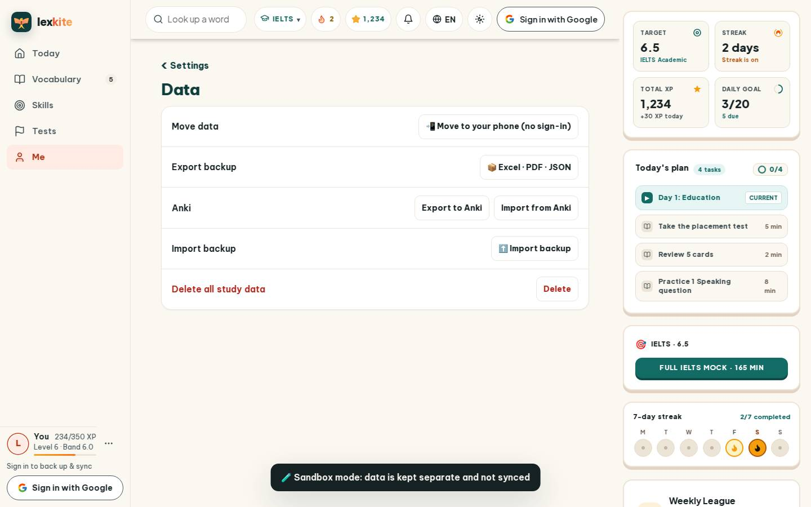
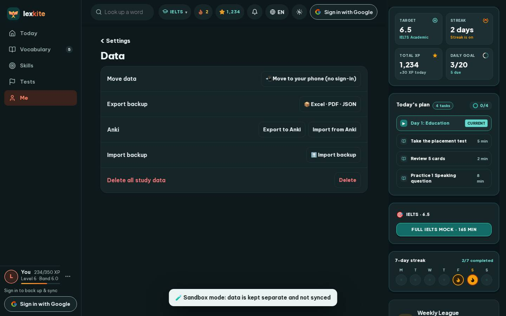

# #/settings/data

Điểm: **95** · độ phủ 100 % · /settings/data

- Chức năng: 100
- Lỗi JS: 100
- Rỗng/lỗi/tải: 100
- Back/Thoát: –
- Tương phản: 100
- Chạm ≥44: 100
- Bố cục: 100
- i18n 15: 100
- Hiệu năng: 79
- Độ đẹp: 76

## Lỗi
- [perf] LCP 4000 ms · CLS 0.0031 · TBT 37 ms
- [beauty] Generic system-style icons lack Duolingo's playful character integration
- [beauty] Flat white cards on beige background feel low-contrast and utilitarian
- [beauty] Top nav bar is cluttered with mixed icon styles (Google 'G' stands out)

## Ảnh
390l 
390d 
1440l 
1440d 
