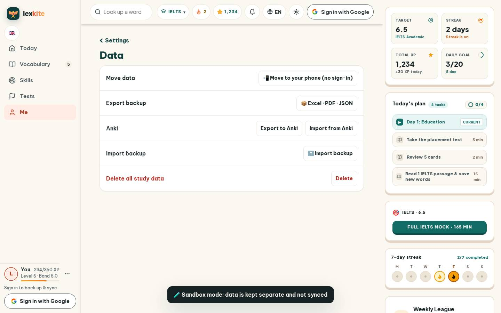

# #/settings/data

Điểm: **95** · độ phủ 100 % · /settings/data

- Chức năng: 100
- Lỗi JS: 100
- Rỗng/lỗi/tải: 100
- Back/Thoát: –
- Tương phản: 100
- Chạm ≥44: 100
- Bố cục: 100
- i18n 15: 100
- Hiệu năng: 83
- Độ đẹp: 74

## Lỗi
- [perf] LCP 3684 ms · CLS 0.0039 · TBT 133 ms
- [beauty] Generic system-style icons lack Duolingo's playful character integration.
- [beauty] Flat, low-contrast buttons feel utilitarian rather than polished.
- [beauty] Layout is clean but visually generic and lacks distinctive brand personality.

## Ảnh
390l 
390d 
1440l 
1440d 
