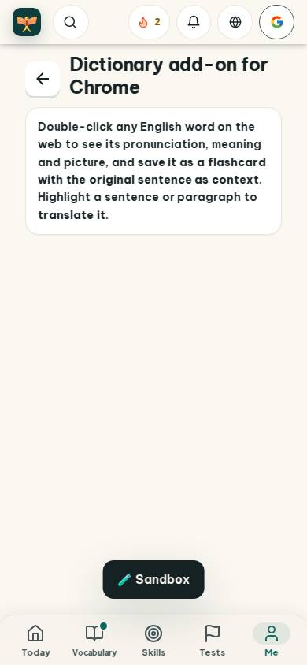
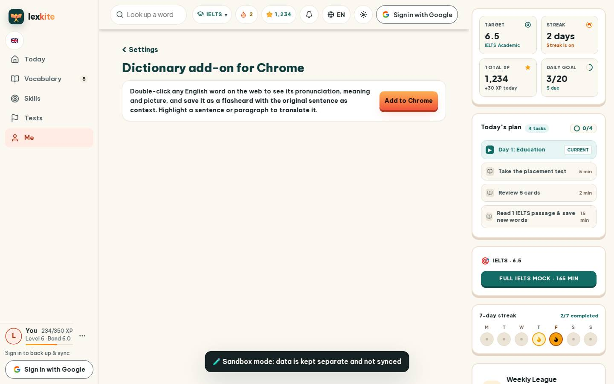
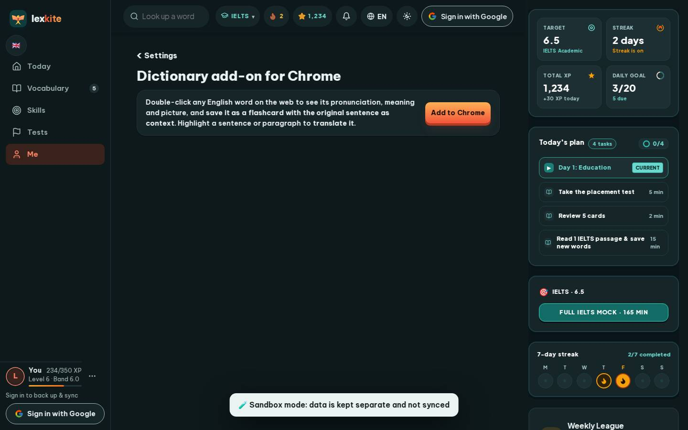

# #/settings/ext

Điểm: **93** · độ phủ 100 % · /settings/ext

- Chức năng: 100
- Lỗi JS: 100
- Rỗng/lỗi/tải: 100
- Back/Thoát: –
- Tương phản: 100
- Chạm ≥44: 100
- Bố cục: 100
- i18n 15: 100
- Hiệu năng: 60
- Độ đẹp: 75

## Lỗi
- [perf] LCP 5324 ms · CLS 0.0039 · TBT 47 ms
- [beauty] Huge empty beige void dominates the middle of the screen.
- [beauty] No clear primary action or CTA button visible.
- [beauty] Layout feels sparse and unfinished, lacking content density.

## Ảnh
390l 
390d 
1440l 
1440d 
