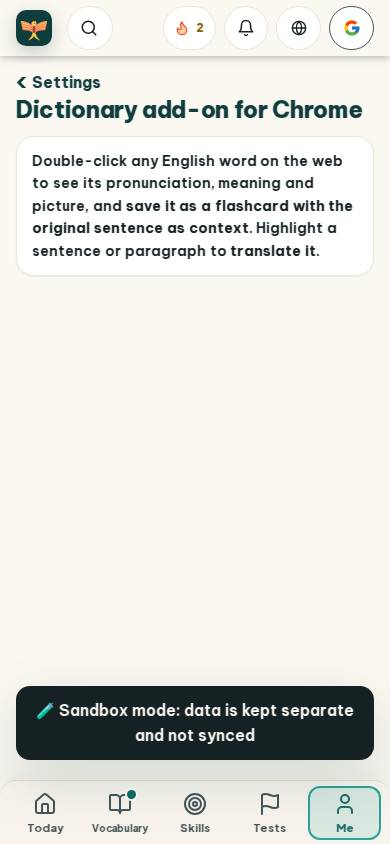
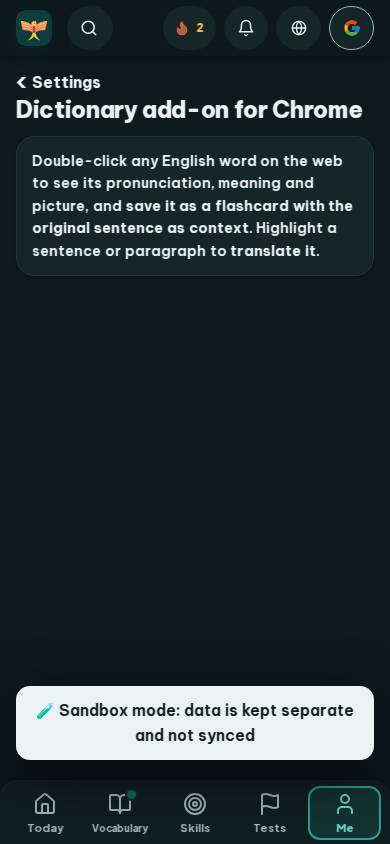
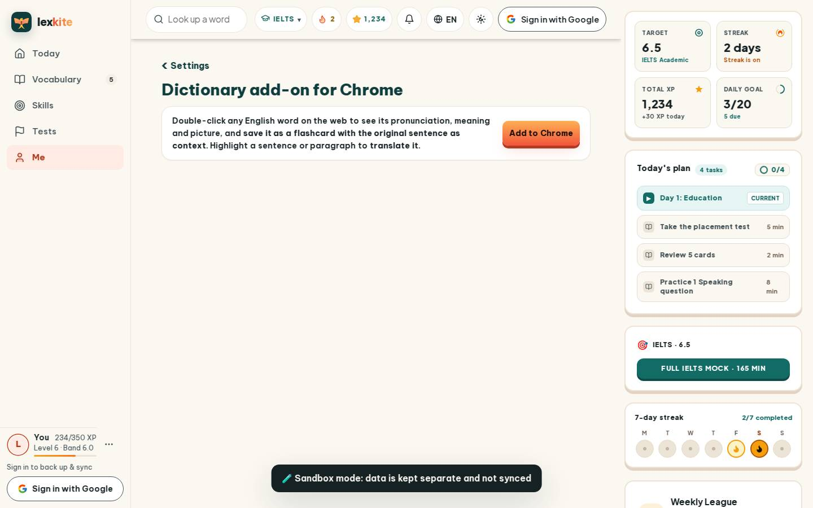
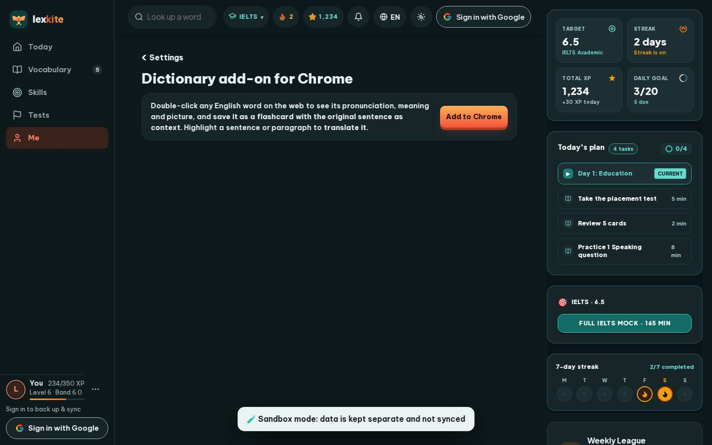

# #/settings/ext

Điểm: **93** · độ phủ 100 % · /settings/ext

- Chức năng: 100
- Lỗi JS: 100
- Rỗng/lỗi/tải: 100
- Back/Thoát: –
- Tương phản: 100
- Chạm ≥44: 100
- Bố cục: 100
- i18n 15: 100
- Hiệu năng: 62
- Độ đẹp: 75

## Lỗi
- [perf] LCP 5184 ms · CLS 0.0031 · TBT 42 ms
- [beauty] Large empty beige void dominates center, no primary action
- [beauty] Generic flat icons, no Duolingo-style character integration
- [beauty] Top nav icons feel cramped and unevenly spaced

## Ảnh
390l 
390d 
1440l 
1440d 
