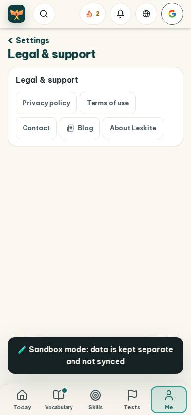
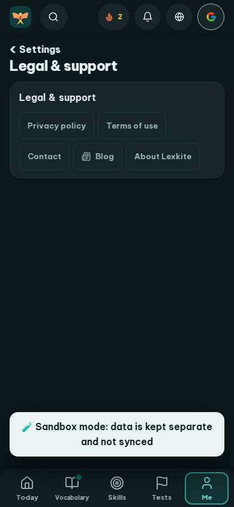
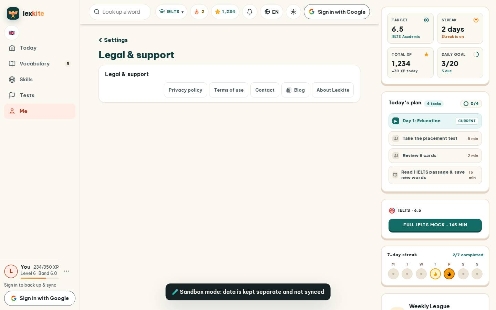
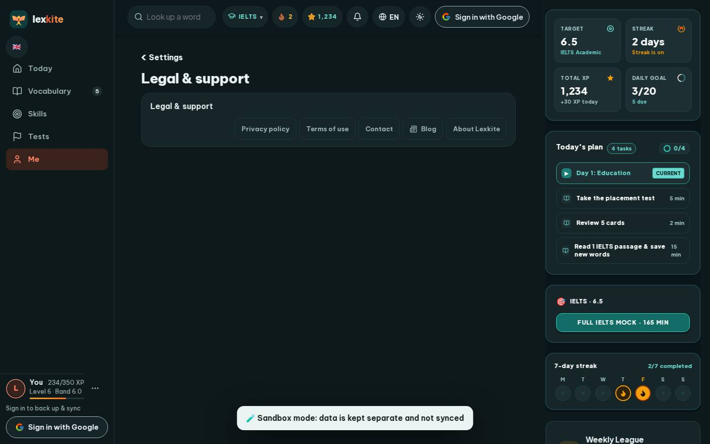

# #/settings/help

Điểm: **95** · độ phủ 100 % · /settings/help

- Chức năng: 100
- Lỗi JS: 100
- Rỗng/lỗi/tải: 100
- Back/Thoát: –
- Tương phản: 100
- Chạm ≥44: 100
- Bố cục: 100
- i18n 15: 100
- Hiệu năng: 86
- Độ đẹp: 72

## Lỗi
- [perf] LCP 3508 ms · CLS 0.0039 · TBT 49 ms
- [beauty] Excessive empty space below the single card
- [beauty] Generic, flat button styling lacks Duolingo's depth
- [beauty] Sandbox banner feels like a debug overlay, not polished UI

## Ảnh
390l 
390d 
1440l 
1440d 
