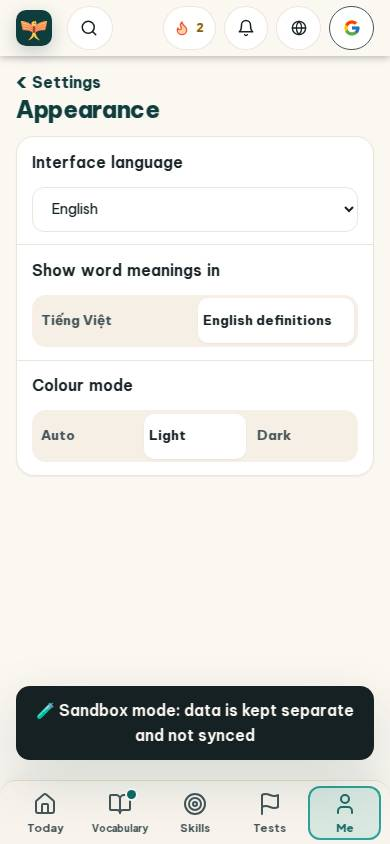
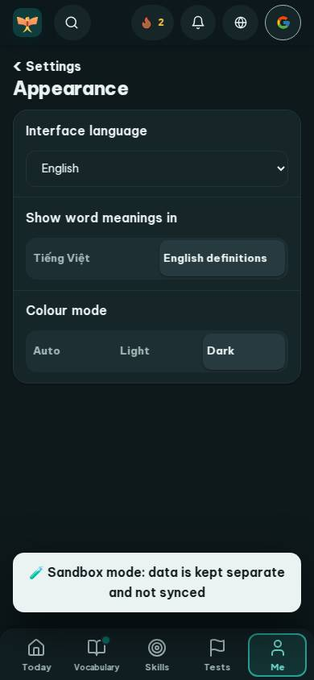
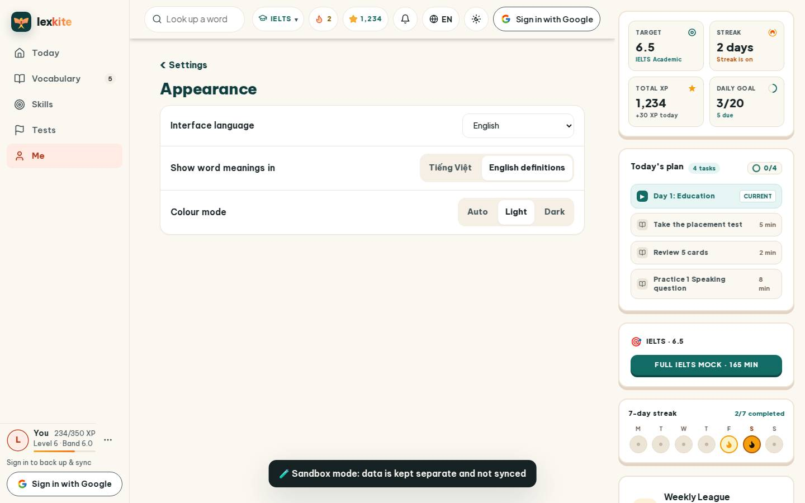
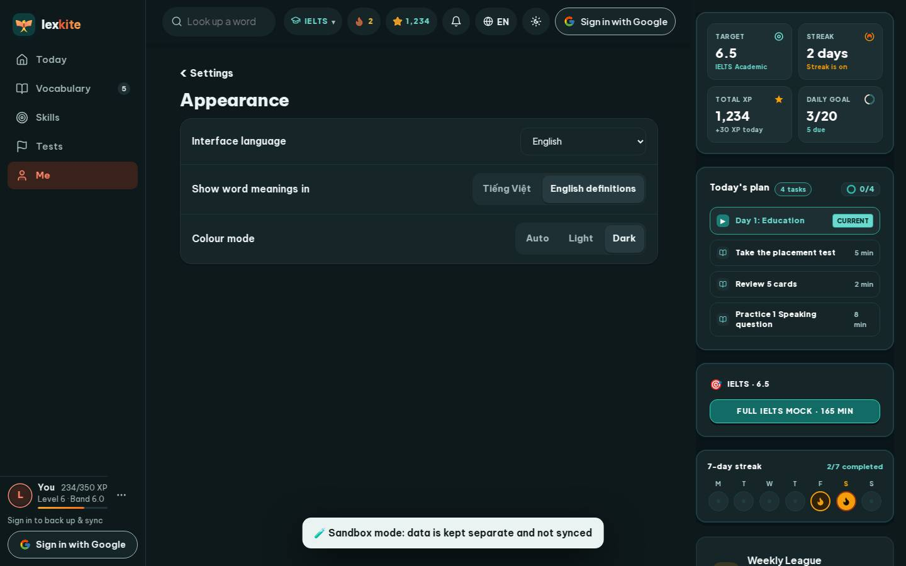

# #/settings/look

Điểm: **95** · độ phủ 100 % · /settings/look

- Chức năng: 100
- Lỗi JS: 100
- Rỗng/lỗi/tải: 100
- Back/Thoát: –
- Tương phản: 100
- Chạm ≥44: 100
- Bố cục: 100
- i18n 15: 100
- Hiệu năng: 78
- Độ đẹp: 82

## Lỗi
- [perf] LCP 4028 ms · CLS 0.0031 · TBT 38 ms
- [beauty] Generic system-style dropdown lacks custom polish
- [beauty] Sandbox banner feels like a raw debug overlay
- [beauty] No character or illustration integration

## Ảnh
390l 
390d 
1440l 
1440d 
